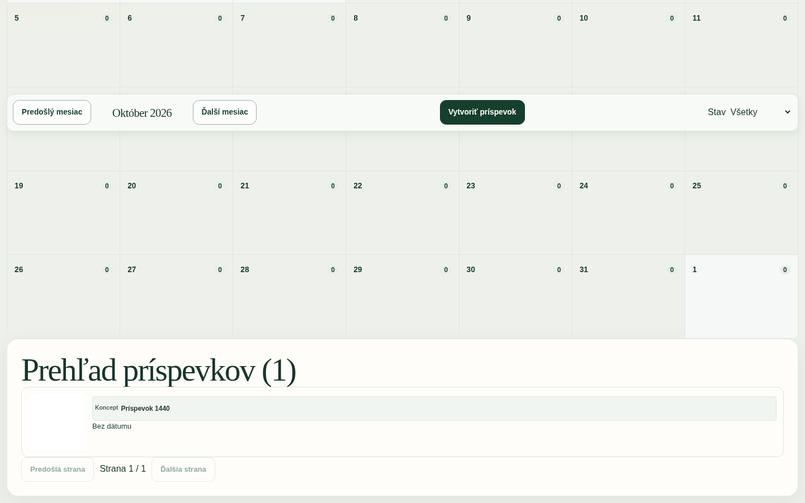
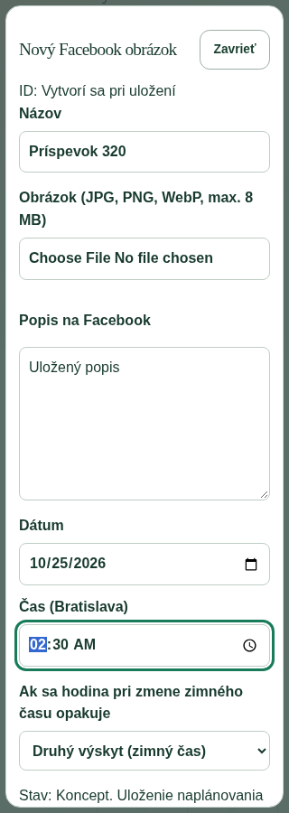

# FACEBOOK-IMAGE-ADMIN-V1 — fáza 1

## Audit a rozsah

Base main: `e05ea6d911a49d753750c5b276284639d25323b1`.
Otvorené PR #845 (article publish/Notion) a #847 (admin UX) boli preverované; ich zmeny sa nepreberajú. Nová navigácia používa spoločné navigačné dáta, aby zostala kompatibilná s úpravou shellu.

| Zistenie | Rozhodnutie |
| --- | --- |
| Existuje AdminShell, autentifikácia, ochrana mutácií a spoločné tlačidlá | Opätovne použité |
| Existuje R2 uploader a immutable `/media` čítanie | Nový prefix `facebook-images`, iba JPG/PNG/WebP, limit 8 MiB |
| Článkový kalendár je viazaný na článkové zápisy | Zachovaný; nové UI používa existujúce kalendárové výpočty a CSS |
| Článkový čas používa lokálnu zónu prehliadača | Samostatný čistý prevod explicitne pre Europe/Bratislava |
| Automatizačný plánovač rieši opakovanie a posúva neexistujúcu hodinu | Nepoužitý: nový editor musí neplatnú hodinu odmietnuť a opakovanú rozlíšiť |
| Chýba samostatné úložisko FB obrázkov | Jedna nová tabuľka, žiadne zmeny existujúcich záznamov |

## Implementácia

`/admin/facebook-obrazky` v skupine Automatizácie: mesačný kalendár, navigácia mesiacov, stavy, deň s predvyplneným dátumom, zoznam s filtrami a stránkovaním po 50 položkách. Kalendár načíta všetky položky v zobrazenom mesačnom okne vrátane okrajových dní; pri viac ako troch položkách v dni ponúkne ich rozbalenie. Voliteľný týždenný pohľad nie je súčasťou fázy.

Natívny dialog umožňuje vytvoriť a znovu načítať celý záznam, nahrať/vymeniť obrázok, upraviť názov, popis a termín, uložiť koncept, naplánovať a zrušiť termín. Zatvorenie, Escape a odchod chránia neuložené údaje. CAS cez verziu vracia 409 a ponechá formulár používateľovi. Záznamy v budúcom stave published sú iba na čítanie.

Termín sa ukladá ako UTC s interpretáciou Europe/Bratislava nezávisle od zóny prehliadača. Jarná neexistujúca hodina sa odmietne; jesenná dvojznačná hodina vyžaduje výber výskytu. Neexistujú sloty, denný limit, minimálny odstup ani zákaz minulého termínu. Samotné uplynutie termínu nič nepublikuje.

Budúce approval/Facebook/Notion metadáta sú iba nullable/pripravené polia. API ich neprijíma. Neexistuje publisher, cron, AI, Notion synchronizácia ani volanie Facebooku. Verejný web a článkový workflow zostávajú bez zmien.

## Migrácia a prevádzkové hranice

`drizzle/0128_facebook_image_posts.sql` je iba pripravená migrácia novej tabuľky a indexov. Produkčný migračný nástroj ju eviduje ako prepared a odmietne jej aktiváciu; existujúci podporovaný target sa neposúva. Žiadny workflow sa nemení. Migrácia nebola aplikovaná na vzdialenú D1, nič nebolo nasadené ani publikované.

Bez tabuľky stránka zobrazí vysvetlenie a zakáže vytváranie; nové API a upload vracajú 503 bez zápisu. Existujúce uploady zostávajú funkčné.

Nasadenie vyžaduje samostatne autorizovaný rollout: pripraviť kontrolu schémy pred/po migrácii, zálohu a ledger, aktiváciu podporovaného targetu a kontrolu D1/R2 bindingov; následne aplikovať migráciu a nasadiť kód. Tento PR tieto produkčné kroky nevykonáva.

Obrázky používajú existujúce verejné `/media` URL, nie sú súkromným úložiskom. Výmena ani zrušenie editora nemaže staré či nepoužité R2 objekty; bezpečné čistenie potrebuje samostatnú politiku referencií a retencie. Pri veľkom množstve položiek môže mesačný kalendár vyžadovať ďalšiu optimalizáciu; termíny zatiaľ nemajú obchodný limit.

## Overenie

- Nové dátové/API testy: 10/10; reálna SQLite migrácia, R2 fixture, CRUD, CAS súbeh, DST, neobmedzené rovnaké termíny, upload/výmena, auth/CSRF, chýbajúca migrácia, budúce metadáta a zákaz externých volaní.
- Playwright: 1 integračný scenár pri 1440, 390 a 320 px; reálny React komponent a API handlery s lokálnou DB/R2 fixture. Vytvorenie, obrázok, uloženie, opätovné otvorenie, dirty ochrana, konflikt, zrušenie plánovania, klávesnica a kontrola horizontálneho pretekania. Prehliadač používa America/Los_Angeles na overenie explicitného Bratislava času.
- Súvisiace existujúce regresie: 31/31 (článkový kalendár, navigácia, image editor).
- Migračná bezpečnosť a produkčný nástroj: 88/88; `db:check-migrations` úspešné.
- `npm run build` úspešné vrátane 14 vstavaných testov.
- Cielený ESLint: 0 chýb, 2 upozornenia pre náhľady cez img.
- Samostatný TypeScript check nie je zelený: repozitár má chýbajúce Cloudflare/D1 ambient typy; úspešný build neprezentujeme ako úspešný plný typecheck.

Screenshoty sú z izolovaného komponentového fixture, nie z produkcie ani celého AdminShell. Nová obrazovka pred zmenou neexistovala, preto nie je porovnanie pred/po.

