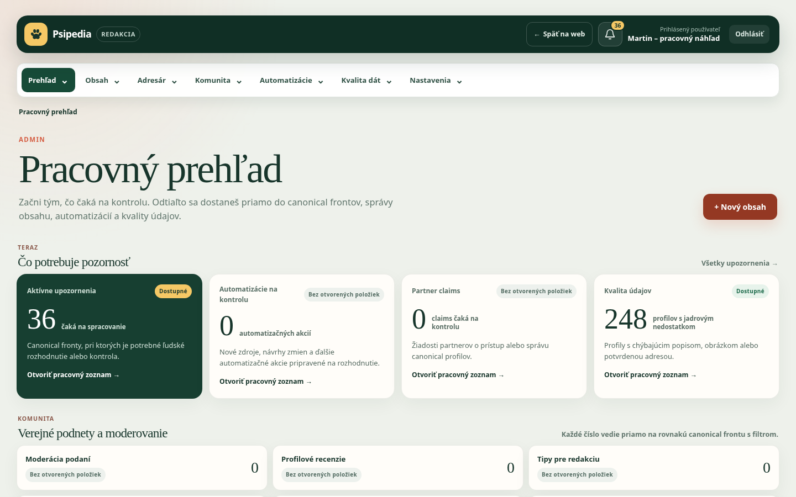
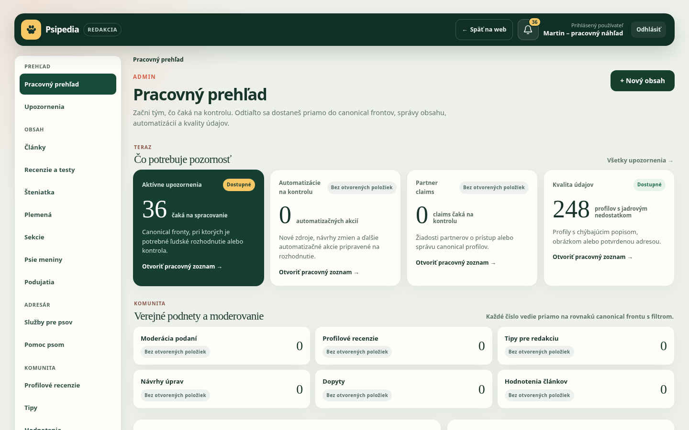
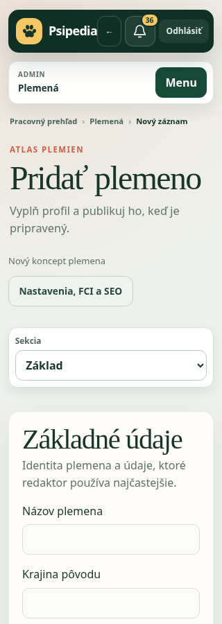
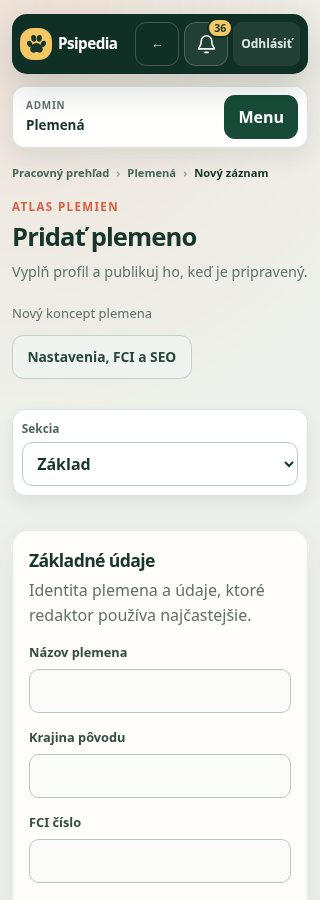
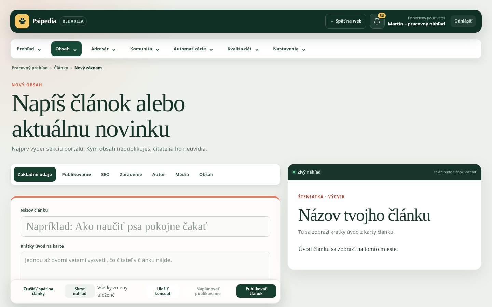
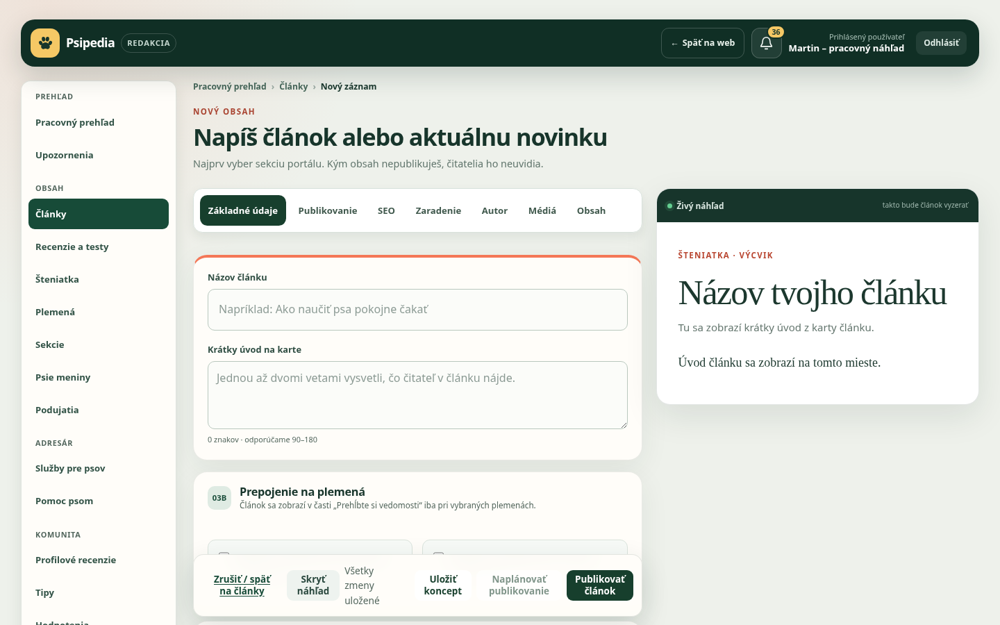
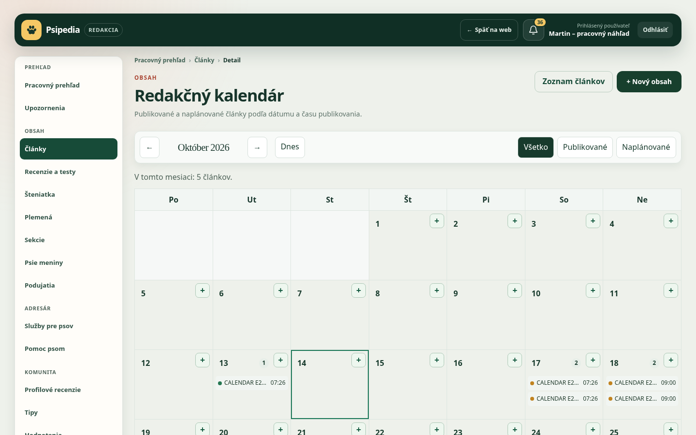
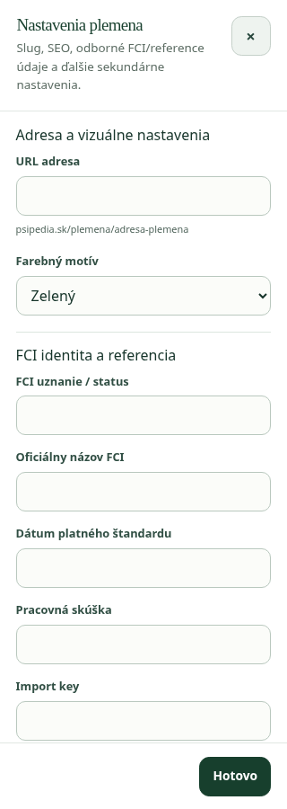
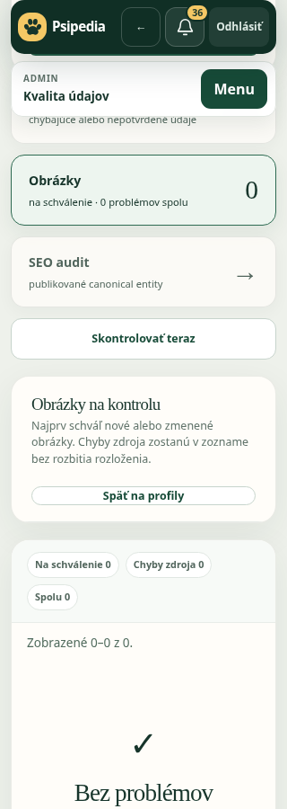

# PSIPEDIA-ADMIN-UX-UNIFICATION-1

Audit a cielená úprava existujúcej administrácie, 14. 10. 2026.

Východiskový fresh main: `c2bf62ef125c5b4076d5a8808398fc0b21e09673`. Počas práce boli mergnuté #818 a #819; finálna vetva používa čerstvý main `59b4f41cb7b6b1aa80418011036c6da001a11aa4`. Pri štarte nebol otvorený žiadny PR; neskôr preverované #818 (Gemini/Notion, následne merged) a #819 (verejné UX/CSS, následne merged); posledný otvorený #820 mení adresné/GEO stores a confirmation logiku, nie súbory tohto PR. Zmeny tohto PR sa s ich súbormi neprekrývajú.

Zohľadnené existujúce editory článkov #807 a plemien #811, kategoriové filtre #800/#813 a existujúci redakčný kalendár. Žiadny editor ani dátová vrstva sa nenahrádza.

## Prioritizovaný audit pôvodného stavu

| Priorita | Dôkaz / krok | Problém | Oprava alebo follow-up |
| --- | --- | --- | --- |
| P1 | 1: shell, desktop screenshot | Primárne moduly sú skryté za rozbaľovacími skupinami; aktívna skupina nestačí na okamžité rozlíšenie aktuálneho modulu. | Existujúca navigačná hierarchia je stále viditeľná v desktopovom sidebare; pôvodné cesty a aria-current ostávajú. Mobilný drawer zostáva. |
| P1 | 3–4: editory, scroll a browser test | Navigácia sekcií používa pevné top hodnoty nezodpovedajúce výške sticky shellu. Profilový editor navyše obmedzoval sticky navigáciu krátkym rodičom. | Meranie existujúcim AdminStickyMetrics; navigácia a scroll margin pod skutočnými sticky ovládačmi. Profilový editor drží spolu navigáciu a pôvodné tlačidlo nastavení. |
| P1 | 6: nastavenia plemena, Shift+Tab | Focus pri spätnom Tab opustil obsah native dialogu. | Existujúci useAdminDialog doplnený o cyklus medzi prvým/posledným viditeľným povoleným ovládačom. Escape, showModal a pôvodné obnovenie focusu zachované. |
| P1 | 4: profilový náhľad, Axe | Drobný nadpis a popisy náhľadu majú nedostatočný kontrast (3,81 a 3,55 proti požadovaným 4,5). | Tmavšie farby iba v admin scope. Bez zmeny verejných komponentov. |
| P2 | 1, 3: desktop; 2: mobil | Veľké nadpisy shellu a sekcií plemena odtláčajú polia a akcie, titulkové polia vizuálne pripomínajú verejný hero. | Kompaktnejšie nadpisy, jednotné polia a labely, zachovaný obsah a sémantika polí. |
| P2 | 3–5: akcie editorov | Pôvodné editory miešajú koralové/zelené primárne akcie, rozdielne písmo a niektoré malé ovládače. | Zelená primárna akcia, konzistentná sekundárna akcia a aspoň 44px výška bežných akcií. Disabled/destructive/pending stavy zostávajú. |
| P2 | 2, 4: 320/390px | Úzky topbar a dvojstĺpcový náhľad potrebujú zohľadniť menší pracovný priestor po pridaní sidebaru. | Menší brand, 44px návrat na web, responzívne karty a skoršie zbalenie náhľadu článku do jedného stĺpca. |
| Follow-up | čítanie všetkých piatich editorov + testy sekcií | Ochrany pri úplnom opustení editora nie sú implementované jednotne. Článok má vlastné dirty/cancel/beforeunload správanie. | Nemení sa ukladanie ani ochrana ostatných editorov. Samostatne navrhnúť a otestovať route-leave ochrany; tento PR neuvádza úplný prechod na iný modul ako bezstratový. |
| Follow-up | 7: monitoring médií | Auditná lokálna fronta nemá kandidátov na schválenie. Úplné schvaľovanie/odmietnutie kandidáta a dôvod odmietnutia nemožno potvrdiť zo screenshotu prázdnej fronty. | Existujúce UI/endpointy ponechané. Pre samostatné overenie použiť reprezentatívne kandidáty, vrátane chybových stavov; nepridávať nový schvaľovací tok. |

## Kroky a screenshoty

Všetky obrázky pochádzajú z tohto lokálneho auditného behu a boli vizuálne skontrolované. Chybová stránka pôvodného zoznamu článkov (stará lokálna schéma) a jeden screenshot kalendára počas načítania CSS boli odmietnuté ako vizuálny dôkaz; nejde o tvrdenie chyby produkcie.

1. **Pracovný prehľad / shell — funkčný, pôvodne zbytočne skrytá navigácia a veľký nadpis.** Aktívny modul je po úprave priamo viditeľný; ďalšie skupiny ostávajú v scrollovateľnom sidebare. Desktopové linky používajú pôvodný registry.

   Pred úpravou:

   

   Po úprave:

   

2. **Plemená / mobil — funkčné polia, upravená hierarchia a čitateľnosť.** Mobilné menu je zachované; veľký sekčný nadpis je zmenšený. 320 aj 390px sú overené browser testom, nielen obrázkom.

   

   

3. **Články / rich text — existujúci editor zachovaný.** Základné údaje sú vyššie, navigácia sekcií a náhľad zostávajú. Existujúci test overil reálne lokálne save/reload, autorov, rich text aj externé video; nevznikla simulácia úspechu.

   

   

4. **Profily služieb / zoznam a editor — funkčné.** Auditované živé vyhľadávanie, filtre, stránkovanie, výber na aktuálnej strane, aktuálne akcie a náhľad. Existujúca AdminStickyEditorNavigation sa drží pod shellom aj po preskoku na médiá. Polia lokality, rozhodovanie o kvalite, Google a mapové správanie sa nemenia. Rovnaké spoločné labely, focus a ovládače používajú aj formuláre Pomoci psom.

5. **Podujatia a redakčný kalendár — funkčné.** Pôvodný editor podujatí a kalendárové dialógy zostávajú. Overené odmietnutie neplatného času/chyby backendu, zachovanie rozpracovaného článku, konflikt rovnakého času, bezpečné plánovanie a čítanie publikovaného článku.

   

6. **Nastavenia plemena / spoločný drawer — opravený klávesnicový focus.** Labels sú prístupné, Tab zostáva v dialógu, Escape ho zavrie a vráti focus na pôvodné tlačidlo; zadaný názov plemena zostáva.

   

7. **Fotografie / monitoring — prázdna fronta, overenie limitované.** Zobrazený je reálny prázdny stav, nie falošné schválenie. Samostatné existujúce IMAGE-EDITOR-1 testy overili lokálne uloženie nezávislého thumbnail/detail nastavenia aj Cancel/Reset. R2, upload/monitoring API, odmietnutie kandidátov a validácia sa nemenia.

   

## Rozsah implementácie a znovupoužité komponenty

- AdminShell, AdminNavigation, AdminBreadcrumbs: rovnaká štruktúra modulov, nový desktopový spôsob zobrazenia, pôvodný mobilný drawer, active state a návratové odkazy.
- AdminStickyMetrics: existujúci ResizeObserver rozšírený o výšku editorového ovládania a premeranie pri zmene cesty. Výška sidebaru sa nepripočítava k vertikálnemu sticky stacku.
- AdminStickyEditorNavigation a existujúci wrapper profilového editora: úprava sticky umiestnenia; žiadna zmena field state alebo uloženia.
- AdminActionButton/Link, AdminModalDialog, AdminSideDrawer a ich existujúci useAdminDialog: rovnaké komponenty, spoločné farby/veľkosti a klávesnicové obmedzenie focusu.
- Existujúce `.admin-field`, `.admin-form-card`, `.admin-editor-actions`, `.admin-editor-message` a admin CSS modules: spoločný admin scope; žiadny nový dizajnový systém ani druhá sada editorov.
- Existujúce admin-list-row, bulk selection/toolbars a tabuľkové wrappery ostávajú; search/filter/pagination/endpoints/auth/validácia sú pôvodné. Žiadne nové hromadné operácie.

Zmenené CSS má admin scope alebo patrí existujúcemu admin module. Verejné CSS súbory, D1 queries, mapy, adries/notion workflowy, Gemini workflowy, storage a API nie sú v diffe. CI iba dopĺňa nový browser test do existujúceho ADMIN-IA-2 jobu.

## Overenie

- **112/112** existujúcich Node admin/editor/kalendár/list kontraktov: admin-ia, admin-navigation-fallback, admin-button-system, admin-events, article-admin-editor, article-editor-notion-parity, breed-admin-v2, admin-runtime-1, editorial-calendar, editorial-calendar-interactions, directory-admin-query, help-admin-query. Žiadne skipped.
- **18/18** Playwright: pôvodný admin-ia-2 + nový admin-ux-unification. Desktop/mobile, všetkých päť editorov, zachovanie údajov pri preskokoch v troch editoroch s existujúcou sekčnou navigáciou a pri zmene viewportu vo formulároch podujatí/Pomoci, bez API mutation pri preskoku, sticky poloha, 320/390px overflow, labels/Axe, dialog focus/Escape a navigácia medzi modulmi.
- **8/8** existujúcich editorových Playwright regresií: článok create/edit, obrázkový editor persist/cancel/reset, rich text keyboard/Axe a plemeno create/edit/save/reload, na oboch projektoch.
- **14/14** existujúcich Playwright interakcií redakčného kalendára.
- **2/2** existujúcich Playwright kontrol kvality údajov, desktop/mobile.
- **8/8** existujúcich Playwright kontrol adresára: search/filter, reset stránkovania, page-scoped selection a keyboard/dialog/Axe/touch targets.
- Spolu **50 finálnych browser testov passed**, 0 failed/skipped v uvedených finálnych behoch. Úvodné behy odhalili opravený kontrast/focus a chyby nových testových locatorov. Dva súbežné behy kolidovali v priečinku trace; boli zopakované sekvenčne s úspešným výsledkom.
- `npm run build`: PASS vrátane pôvodných 10+4 breed/artifact testov. `git diff --check`: PASS.
- `npm run lint`: PASS (0 errors); repo a ignorované lokálne helper/generated files majú existujúce warnings. Cielený lint menených TS/TSX/MJS súborov: PASS, 0 errors/warnings.
- **Úplný TypeScript check nie je zelený.** Najprv chýbali Cloudflare runtime typy. Po lokálnom `wrangler types` a referencii z ignorovaného next-env.d.ts má fresh baseline aj vetva rovnaké existujúce diagnostiky, bez nových. Porovnanie používa rovnakú lokálnu typecheck konfiguráciu a virtuálne načíta čisté verzie menených súborov z HEAD, aby nemenilo pracovný checkout. Neopravujeme rozsiahle typové chyby v Gemini, mapách alebo serverovej vrstve v tomto UX PR. Lokálne porovnanie s runtime typmi generovanými z dist/server/wrangler.json: 668 diagnostík na baseline, 668 na vetve, 0 nových; nejde o úspešný full tsc.

Browser: Playwright z lockfile, lokálne nainštalovaný `/usr/bin/chromium`; desktop a Pixel 7 projekty, konkrétne viewporty 1440, 390 a 320px (kalendár tiež 1280/390/430px podľa existujúcich scenárov). Použitý iba explicitný lokálny admin bootstrap. Lokálna D1 bola s výslovným súhlasom používateľa doplnená **existujúcimi** migráciami main a existujúcimi izolovanými E2E fixtures. Nevznikol nový migračný súbor ani produkčný zápis.

Reprodukcia: štandardné `npm run dev` v izolovanej D1 so schema/fixtures podľa existujúcich CI jobov, `E2E_BASE_URL=http://localhost:5173`, `PSIPEDIA_E2E_LOCAL_BOOTSTRAP=1`; potom `npx playwright test tests/e2e/admin-ia-2.spec.ts tests/e2e/admin-ux-unification.spec.ts --workers=1`. Ostatné vyššie uvedené suite sú existujúce súbory. Prístupnosť znamená konkrétne keyboard/focus/label checks a Axe bez serious/critical findings na preverovaných povrchoch, nie úplnú certifikáciu.

## Samostatné follow-upy

1. Harmonizácia route-leave ochrany neuložených zmien medzi editormi, bez zásahu do ich bezstratových save kontraktov. V tomto PR sa potvrdzuje zachovanie stavu pri **vnútornom** prepínaní sekcií, nie ľubovoľné opustenie stránky.
2. Detailnejšie obrazové schvaľovanie s reálnymi testovacími kandidátmi; dôvod zamietnutia iba tam, kde ho existujúci systém podporuje. Nepridávať novú media API/R2 schému.
3. Forenzné audity adries, mapovania, kvality a Notion synchronizácie zostávajú samostatné; žiadny ich funkčný problém tento PR neprehlasuje za vyriešený.
4. Samostatný TypeScript/runtime typing cleanup baseline. Tento PR neprináša nové diagnostiky, ale celý repozitár nemá úspešný tsc.
5. Úplný výkonový profil nad veľkou produkčnou sadou a všetky kombinácie starších formulárov; tento PR neuvádza vymyslené percentá zrýchlenia ani úplný audit všetkých error/empty/loading stavov.

PR je samostatný, bez merge a bez auto-merge. Nevykonáva sa deployment.
