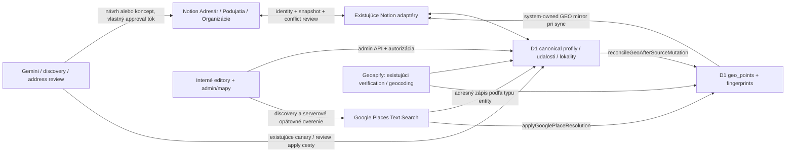

# ADDRESS-ADMIN-AUDIT-1 — technický audit (1/11)

Režim: read-only analýza zdrojov, docs-only PR. Východiskový `main`:
`f921d460fb5b888eed62c273031a7e39f74bca4d` (novší než SHA zo zadania).
Žiadne runtime úpravy, migrácie, produkčné čítanie/zápisy, provider volania ani
zapnutie automatizácií. Živá D1 schéma, živé Notion properties, konfigurácia,
počty a kvalita produkčných záznamov **neboli overené**. Všetky „existuje“ nižšie
znamenajú potvrdené v kóde/migráciách, nie potvrdené nasadenie.

Súvisiace návrhy: [kontrakt](data-contract.md), [roadmapa](implementation-roadmap.md).
Audit je technický; vizuálne návrhy Mapy nie sú výsledkom screenshotového UX auditu.

## 1. Mapa tokov a autorít

Tento diagram agreguje viac ciest; neznamená, že každá automatizácia najprv píše
Notion alebo že Google confirmation ihneď spúšťa Notion sync.

| Tok | Potvrdený zdroj a funkcia | Dôsledok |
|---|---|---|
| Canonical → GEO | [geo-store](../../lib/geo-store.ts): `getGeoSourceLocation`, `reconcileGeoAfterSourceMutation`, `syncGeoPointAfterSourceChange` | Tri target typy: `DIRECTORY_PROFILE`, `MANAGED_EVENT`, `ORGANIZATION_LOCATION`; organizácia sama nie je GEO target. Zmeny zdroja aktualizujú fingerprint a môžu zneaktuálniť riešenie. |
| Google → Admin → D1 | [confirmation](../../lib/admin-google-place-confirmation.ts): `confirmAdminGooglePlace` | Server zopakuje discovery a prijme iba Place ID z aktuálnych výsledkov; odmieta manual override a chráni explicitne neverejné miesto. |
| Notion Adresár ↔ D1 | [directory sync](../../lib/notion-directory-sync.ts): `runNotionDirectorySyncSweep`, `notionDirectoryUpdateSafety` v [safety](../../lib/notion-directory-update-safety.ts) | Snapshot a mapping `directory_notion_sync`; potvrdenie prevádzky, provider verification, mediálne a GEO cesty sú súčasťou syncu. Nie je to jednoduchý copy missing fields. |
| Notion Podujatia/Pomoc ↔ D1 | [sync](../../lib/notion-events-help-sync.ts): `runNotionEventsHelpSyncSweep`; [adaptéry](../../lib/notion-events-help-adapters.ts): `applyNotionToCanonical` | Agenda identity a baseline hash; obojstranné rozdielne zmeny vedú do konfliktu. |
| D1 → Notion export | [sources](../../lib/notion-bulk-sources.ts): `loadNotionBulkServices`, `loadNotionBulkEvents`, `loadNotionBulkOrganizations`; [mirror](../../lib/notion-geo-mirror.ts): `notionGeoMirrorProperties` | GEO properties sú systémové. Organizácie exportujú adresu iba pod podmienkou SITE + resolved exact public bod; `Adresa` je system-owned. |

## 2. Existujúce polia, schémy a migrácie

`—` = samostatný canonical stĺpec v kontrolovanej schéme chýba.

| Údaj | Služby: `directory_profiles` | Podujatia: `managed_events` | Organizácie: `organization_locations` |
|---|---|---|---|
| Verejná/textová adresa | `address` | `address`, názov miesta `venue` | `address`; legacy adresa aj v `help_organizations` |
| Kraj / okres / obec | `region` / `district` / `city` | `region` / — / `city` | `region` / `district` / `city` |
| PSČ / ulica / číslo domu | `postal_code` / `street` / `house_number` | — / — / — | — / — / — |
| Formát a potvrdenie adresy | `address_format`, `service_address_confirmation` | — | rola `SITE`, `LEGAL_SEAT`, `SERVICE_AREA`, `UNSPECIFIED`; nie potvrdenie adresy |
| Online | GEO source adresára tu používa fyzické polia, nie všeobecný nový mode enum | GEO source deteguje `online` z `region` alebo `city`; editor používa existujúci región Online | service-area je rola lokality, nie online enum |
| Krajina | GEO source `SK` | GEO source `SK` | `country_code` |
| Google ID / lat / lon / stav / fingerprint | spoločný `geo_points` FK `directory_profile_id` | spoločný `geo_points` FK `managed_event_id` | spoločný `geo_points` FK `organization_location_id` |

Zdroj: [db/schema.ts](../../db/schema.ts) `directoryProfiles`, `managedEvents`,
[organization schema](../../db/help-organization-schema.ts) `organizationLocations`,
[geo schema](../../db/geo-schema.ts) `geoPoints`. GEO má `source_fingerprint`,
`resolved_source_fingerprint`, `google_place_source_fingerprint`, `google_place_id`,
`google_place_matched_at`, `geocode_status`, `manual_override`, provider/provenance,
retry/attempt metadata. `provider_result_id` dopĺňa migrácia 0077 a runtime SQL
v `geo-store`; samotný uvedený Drizzle geo model ho neuvádza. Nenahrádzať provider ID
Google ID bez rozlíšenia providera.

Relevantný migračný reťazec:

- [0002](../../drizzle/0002_spicy_ultragirl.sql) podujatia;
  [0003](../../drizzle/0003_talented_cammi.sql) adresár;
  [0018](../../drizzle/0018_cold_nico_minoru.sql) okres a verejné indexy adresára.
- [0036](../../drizzle/0036_help_organizations_foundation.sql) organizácie;
  [0040](../../drizzle/0040_organization_locations_foundation.sql) viac lokalít,
  primary a migrácia legacy lokality; zachovať rozdiel prevádzka/sídlo.
- [0064](../../drizzle/0064_geo_foundation.sql) GEO; [0074](../../drizzle/0074_directory_service_address.sql)
  štruktúrovaná adresa a confirmation; [0077](../../drizzle/0077_directory_geo_provider_result_id.sql)
  provider ID; [0090](../../drizzle/0090_geo_google_place_identity.sql) Google identity.
- [0047](../../drizzle/0047_notion_event_sync.sql), [0098](../../drizzle/0098_directory_notion_bidirectional_sync.sql),
  [0108](../../drizzle/0108_notion_events_help_bidirectional_sync.sql) Notion mapping;
  [0093](../../drizzle/0093_automation_address_review.sql) address review;
  [0113](../../drizzle/0113_gemini_automation_foundation.sql) a
  [0115](../../drizzle/0115_gemini_notion_bridge.sql) Gemini koncepty/bridge.

## 3. Editory, validácia a verejný text

Adresár: [AdminDirectoryEditor](../../components/admin-directory-editor.tsx)
oddeľuje `publicAddress` od technických polí; má existujúci Google panel aj
`SlovakiaLocationSelector`. Ulica je v provider toku read-only po výbere, PSČ
a číslo sa dopĺňajú ručne; [autocomplete](../../components/directory-address-autocomplete.tsx)
umožňuje aj vedomý numberless/locality postup. Cieľ „ulicu možno voľne zadať“
vyžaduje úpravu interného formulára, nie nový selector alebo nový provider systém.
[directory-address-save](../../lib/directory-address-save.ts):
`withVerifiedDirectoryAddress`, `withUnconfirmedDirectoryAddress`,
`directoryPhysicalAddressChanged`, `preserveDirectoryPhysicalAddress` už existujú.
[directory-service-address](../../lib/directory-service-address.ts):
`evaluateDirectoryServiceAddress` rozlišuje missing/incomplete/review/complete,
normalizuje PSČ, podporuje STREET a MUNICIPALITY_NUMBER aj numberless miesto.
`directoryCanonicalPublicAddress` neznamená, že editorový verejný text sa musí
v každej vetve automaticky prepísať. Verejný formát musí zostať nezmenený.

Podujatia: [AdminEventEditor](../../components/admin-event-editor.tsx) +
[event-store](../../lib/event-store.ts) `normalizeManagedEventInput`: mesto je text, región
musí byť z existujúceho zoznamu vrátane Online, nie validovaná trojica kraj/okres/obec.
`rowToEvent` pri neznámom uloženom regióne používa fallback Online:
riziko maskovania legacy chyby, nie dôkaz, že produkčné riadky sú chybné.

Organizácie: [AdminOrganizationEditor](../../components/admin-organization-editor.tsx),
[location input](../../lib/organization-location-admin.ts) `normalizeOrganizationLocationAdminInput`
validuje rolu, typy, kontrolné znaky, primary a poradie; **neoveruje hierarchiu SK**.
[location write](../../lib/organization-location-admin-write.ts) zachováva parent ID,
konflikty a primary pravidlá. Nevytvárať adresu organizácie ako nový paralelný profil.

Ostatná Pomoc psom: [helpCases](../../db/schema.ts) má `city`, `region`,
`location_note`; [lost-found schema](../../db/lost-found-dogs-schema.ts) a
[adoption schema](../../db/adoption-schema.ts) majú lokalitné polia. V kontrolovaných
modeloch nejde o plný štruktúrovaný street-address kontrakt ani nové GEO targety.
[Notion adaptéry](../../lib/notion-events-help-adapters.ts) `helpPayload`,
`lostFoundPayload` prenášajú locality. Návrh nerozširovať na fyzickú adresu zvieraťa
bez samostatného účelu a privacy rozhodnutia.

## 4. Slovenský číselník

[slovakia-locations](../../lib/slovakia-locations.ts): `SLOVAK_REGIONS`,
`SLOVAK_DISTRICTS_BY_REGION`, `SLOVAK_MUNICIPALITIES_BY_DISTRICT`,
`resolveSlovakLocation`, `getSlovakDistricts`, `getSlovakMunicipalities`,
`searchSlovakMunicipalities` sú spoločný offline zdroj.
Read-only parsovanie aktuálneho súboru potvrdilo 8 krajov, 79 unikátnych okresov,
2 927 obecných položiek; district keys presne zodpovedajú okresom, žiadny prázdny
okres ani duplicita v jednom okrese. Rovnaký názov obce v rôznych okresoch je platný.
Toto overuje konzistenciu snapshotu, nie jeho aktuálnosť voči živému REGPJ.

[SlovakiaLocationSelector](../../components/slovakia-location-selector.tsx)
resetuje okres/obec po zmene kraja, obec po zmene okresu, ukladá obec iba výberom;
vyhľadáva bez diakritiky a limituje návrhy na 80. Server musí znova zavolať
`resolveSlovakLocation`; UI nie je bezpečnostná hranica. D1 textové stĺpce nemajú
FK do číselníka. Verejné filtre/indexy adresára z `db/schema.ts` nemeníme.

## 5. Google confirmation: presný write set

| Sekcia | Adresný zápis po potvrdení | GEO zápis |
|---|---|---|
| Služby | `updateManagedDirectoryProfileLocationFromGooglePlace`: region/district/city, formatted `address`, postal_code, street, house_number, odvodený address_format, confirmation, search_text, updated_at/by | `applyGooglePlaceResolution`: súradnice, provider `google_places`, Place ID, provider ID ak schema available, oba resolved/Google fingerprints, timestamps, RESOLVED a attempt count |
| Podujatia | **Žiadny UPDATE adresných polí udalosti** v `confirmAdminGooglePlace`; venue/address/city/region zostávajú pôvodné | rovnaký GEO write set pre MANAGED_EVENT; Online je odmietnuté |
| Organizácie | `updateOrganizationLocationFromGooglePlace`: address, city, district, region, country_code na existujúcej lokalite; chýbajúce Google locality hodnoty fallback na existujúce. PSČ/ulica/číslo sa samostatne nezapisujú | rovnaký GEO write set pre ORGANIZATION_LOCATION |

Zdroj funkcií: [directory-store](../../lib/directory-store.ts),
[location-write](../../lib/organization-location-admin-write.ts),
[confirmation](../../lib/admin-google-place-confirmation.ts), [geo-store](../../lib/geo-store.ts).
Kontakty, web, obsah, médiá a SEO nie sú v Google location UPDATE.
Neverejná vetva confirmation nastaví HIDDEN a skončí pred `applyGooglePlaceResolution`;
nie je správne tvrdiť, že každý Google výber vždy uloží ID a súradnice.

`googlePlaceDirectoryLocation` najprv zachová existujúcu platnú kanonickú trojicu.
Inak mapuje Google locality/sublocality na snapshot; pri nejednoznačnosti nechá
okres prázdny a môže zachovať raw mesto. Inkompletný Google výsledok môže vymazať
predchádzajúce PSČ/ulicu/číslo (používa prázdne fallbacky), pritom nastaví confirmation.
Potvrdenie miesta teda nie je záruka kompletnosti adresy; treba review a preview diff.

[organization workflow](../../lib/organization-google-maps-workflow.ts)
`canonicalOrganizationLocation` preferuje SITE, primary, poradie, ID.
`confirmOrganizationProfileGooglePlace` môže pri chýbajúcej lokalite vytvoriť SITE;
opätovné discovery prebehne aj v spoločnej confirmation. Existujúcu nesprávnu rolu
automaticky nemení. Multi-location organizácia sa nesmie sploštiť na jedinú adresu.

[Google provider](../../lib/google-places-provider.ts) `searchGooglePlacesText`
používa API New Text Search, jazyk sk, region SK, najviac 5 výsledkov/volanie,
timeout a explicitné auth/rate/provider chyby; structured address číta addressComponents.
[target discovery](../../lib/google-place-target-discovery.ts) `targetQueries`
skladá názov/venue/adresu/locality a fallback názov + Slovensko.
[directory discovery](../../lib/google-place-directory-discovery.ts)
`discoverGoogleDirectoryPlaces`, `evaluateGoogleDirectoryAutoMatch` už riešia scoring.
Confirmation môže znamenať viac platených search volaní; tento audit ich nevykonal.

[bulk](../../lib/google-place-bulk.ts) `selectGooglePlaceBulkTargets`,
`processGooglePlaceBulkTarget`: najviac 100, cursor via filter fingerprint a name/type/id;
skip manual override, explicit private, not-required, unpublished a aktuálny Place.
Adresár má bezpečnostný auto-match tok, udalosti/organizácie zostávajú REVIEW s kandidátom.
Nevytvárať nový bulk engine ani rozširovať auto-confirm bez samostatnej akceptácie.

## 6. Geoapify: závislosti na neskoršiu náhradu

| Závislosť | Súbory a entry point | Bezpečná náhrada až po |
|---|---|---|
| geocode/autocomplete/place details | [geoapify-geocoder](../../lib/geoapify-geocoder.ts) `GeoapifyGeocoder`; [directory provider](../../lib/directory-address-provider.ts) `verifyDirectoryCanonicalAddress`; [API autocomplete](../../app/api/admin/directory/address-autocomplete/route.ts) | manuálny input + Google normalizácia + kompatibilita existujúceho provider_result_id |
| generický GEO preview/apply a fallback | [geo-service](../../lib/geo-service.ts); [geo API](../../app/api/admin/geo/[targetType]/[id]/route.ts); [geo-operations](../../lib/geo-operations.ts) | zachované manual override, visibility, fingerprint a provider-failure pravidlá |
| exact automation/migration | [exact auto](../../lib/directory-exact-geo-auto.ts), [exact migration](../../lib/directory-exact-geo-migration.ts) | audit idempotencie, historických bodov a bounded canary |
| adresný enrichment/review/import | [enrichment](../../lib/data-automation-directory-address-enrichment.ts), [canary](../../lib/address-enrichment-canary.ts), [review](../../lib/data-automation-address-review.ts), [research import](../../lib/directory-address-research-import.ts) | jednotný návrh adresy a review bez povinného Geoapify confirmation |
| Notion confirmed address pull | [directory sync](../../lib/notion-directory-sync.ts) provider verification vetvy | chránený Google lock a nový missing-only merge |
| admin stav/copy | [geo location](../../components/admin-geo-location.tsx), [geo operations](../../components/admin-geo-operations.tsx), [canary UI](../../components/admin-address-enrichment-canary.tsx) | samostatné interné UX overenie |
| attribution verejnej mapy | [map-query](../../lib/map-query.ts) provider attribution | osobitné rozhodnutie mimo tejto roadmapy; existujúce Geoapify dáta stále potrebujú attribution |

Provider, secret, attribution ani fallback sa v tomto PR neodstraňuje. Starý canary
text v [admin-google-places-canary](../../components/admin-google-places-canary.tsx)
hovorí o Geoapify ako authority, hoci nový Google confirmation priamo zapisuje GEO:
dokumentačný/UX nesúlad medzi starou a novou cestou, nie dôvod zmeniť verejnú mapu.

## 7. Notion úplnosť a ochrany

| Pole | Adresár | Podujatia | Organizácie |
|---|---|---|---|
| Kraj | read/write | read/write | read/write locality |
| Okres | read/write | v kontrolovanom event adaptéri chýba | read/write locality |
| Mesto | read/write | read/write | read/write locality |
| PSČ / Ulica / Číslo domu | všetky read/write | chýbajú v canonical source/adaptéri | chýbajú v canonical source/adaptéri |
| Adresa | read/write editorový text | read/write | system-owned podmienený export; Notion pull ju nepoužíva na adresu lokality |

Tabuľka potvrdzuje kód v `notion-directory-sync`, `notion-bulk-sources` a
`notion-events-help-adapters`. **Žiadne live Notion property názvy/typy ani ich
prítomnosť neboli priamo overené.** Nezamieňať „adaptér chýba“ s „Notion property
neexistuje“. Organizácia `organizationLocationFromNotion` vytvorí UNSPECIFIED lokalitu
iba z locality a pri update zachová jej adresu; chýba požadovaný Notion → fyzická adresa tok.

Existujúce ochrany nie sú jednotné:

- `notionDirectoryUpdateSafety` blokuje downgrade confirmed prevádzky cez unchecked
  Notion boolean. Ak Notion zostáva confirmed a adresa sa zmení, cesta overuje cez
  Geoapify a môže prepísať canonical polia; nie je to univerzálny Google Place lock.
- `applyNotionToCanonical` pre event zablokuje zmenu address/venue/city/region pri
  aktuálnom Google Place. `assertOrganizationPlaceNotOverwritten` blokuje zmenu
  locality reprezentovanej organizácie; address nie je editable input tejto vetvy.
- [bidirectional decision](../../lib/notion-bidirectional-reconciliation.ts)
  `decideBidirectionalChange`: baseline + oba snapshoty, bez last-writer-wins pri
  obojstrannej rozdielnej zmene. Events/help GEO mirror v samostatnom passe
  nezahŕňa systémové GEO do editable hash; má aj schema-only baseline recovery.
- Google confirmation sama nevolá Notion transport; spätný export je cez existujúci
  sync. Dostupnosť príznakov, harmonogramu a čas doručenia v produkcii sú neoverené.

## 8. Automatizácie: čo z 8-krokového scenára existuje

| Budúci krok | Aktuálny stav v kóde |
|---|---|
| 1. chýba adresa v D1 aj Notione | Nie je preukázaný spoločný missing-in-both gate pre všetky tri sekcie. Existujú jednotlivé source/snapshot a enrichment vetvy. |
| 2. verejný research | `data-automation-directory-address-enrichment` zbiera labelled/postal evidence a bounded search; `address-enrichment-canary` má preview/apply. |
| 3. chýbajúca adresa + zdroj do Notion | `scripts/gemini-notion-directory-fields.mjs` pripravuje Adresa/Ulica/Číslo domu; `bridgeGeminiCandidateToNotion` a `mapGeminiDirectoryCandidate` podporujú koncept. Nie dôkaz missing-only doplnenia existujúceho profilu. |
| 4. Notion → admin | Directory sync a existujúci editor Gemini Notion konceptov fungujú v kóde; organizácia nemá pull fyzickej adresy. |
| 5–6. admin Google → adresa + GEO | Existujúci confirmation tok; rozdiely write setov sú v kapitole 5. Event doplnenie adresy chýba. |
| 7. Notion spätný export | Existujúce source/mirror/sweep; nie okamžitý garantovaný push všetkých štruktúrovaných polí. |
| 8. opakovaný beh neprepíše potvrdené | Čiastkové ochrany/review a fingerprint skip; jednotná missing-only ochrana každej adresnej write cesty sa musí zaviesť/overiť. |

Zdroj: [Gemini bridge](../../lib/gemini-automation-notion-bridge.ts)
`bridgeGeminiCandidateToNotion`, [Gemini review](../../lib/gemini-notion-directory-review.ts)
`saveGeminiDirectoryDraft`, `approveGeminiDirectoryDraft`,
[agent fields](../../scripts/gemini-notion-directory-fields.mjs),
[address review](../../lib/data-automation-address-review.ts) `resolveAutomationAddressReview`.
Review už má snapshot/guard a revalidation; znovu ho neimplementovať. Všetky
existujúce cron/agent/run/publish nastavenia zostali bez zásahu.

## 9. Mapy: zachovať funkcie

[page](../../app/admin/mapy/page.tsx) `AdminMapsPage` vyžaduje admin auth a odovzdáva
group/category/query/page/pageSize do `loadGeoAdminOperatorProfiles` v
[operator](../../lib/geo-admin-operator.ts). Inbox zobrazuje nevyriešené položky;
stránkovanie je SQL LIMIT/OFFSET, default 50, možnosti 25/50/100, bounded page.
Bulk cursor je samostatný mechanizmus, nesmie sa zlúčiť s page indexom.
[dashboard](../../components/admin-geo-operator-dashboard.tsx) zachováva tri sekcie,
kategórie/search, bulk, manuálne potvrdenie, not-required a editor odkazy.

Neskorší vizuálny návrh: jeden kompaktný filter riadok, jasné oddelenie globálnej
bulk akcie od row akcií, stručný stav s detailom na rozbalenie, rovnaké rozostupy
a typografia interných editorov. Zachovať labely, keyboard focus, URL parametre,
pageSize, výsledky aj všetky API payloady. Pred realizáciou zachytiť screenshoty
a vykonať funkčné porovnanie; nejde o odporúčanie meniť query alebo vyradenie akcií.

## 10. Priority a neimplementovať znova

**Kritické riziká na overenie/opravnú fázu:** rozdielny Google lock v directory
Notion pull; neatomický viac-krokový source → GEO zápis a súbežné zmeny; Google
výsledok mimo existujúcej platnej locality môže ponechať starú trojicu; chýbajúce
Google components môžu vyprázdniť fields. Sú to potvrdené vetvy/riziká v kóde,
nie potvrdené produkčné incidenty. Počet dotknutých profilov je neznámy.

**Potrebné zjednotenia:** event/organization structured fields, serverová locality
validácia, missing-only Notion pull organizácií, konzistentná confirmation vs
completeness, manuálny street input, jednotný review diff a retry/idempotencia.
**Čisto vizuálne:** zjednodušenie Mapy a staré provider texty v interných nástrojoch.

Znovu nepísať: slovenský číselník/selector, geo_points a fingerprint lifecycle,
Google provider/discovery/confirmation, privacy/manual ochrany, directory exact
address evaluator, organization multi-location/primary pravidlá, bulk cursory,
Notion identity/baseline/conflict/recovery/mirror, Gemini koncept review ani
address research review. Rozšíriť existujúce moduly podľa [roadmapy](implementation-roadmap.md).

## 11. Overenie tohto PR

Lokálne iba kontrola konzistencie číselníka, existencie relatívnych odkazov,
docs-only diff a `git diff --check`. Build, plný test suite, aplikácia migrácií,
live Notion a platené provider volania neboli spustené. Testy v roadmape sú
plán budúcich implementačných fáz, nie vykonané výsledky tohto auditu.
