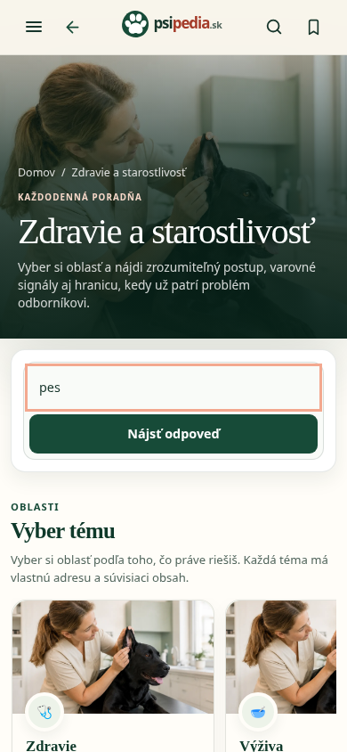
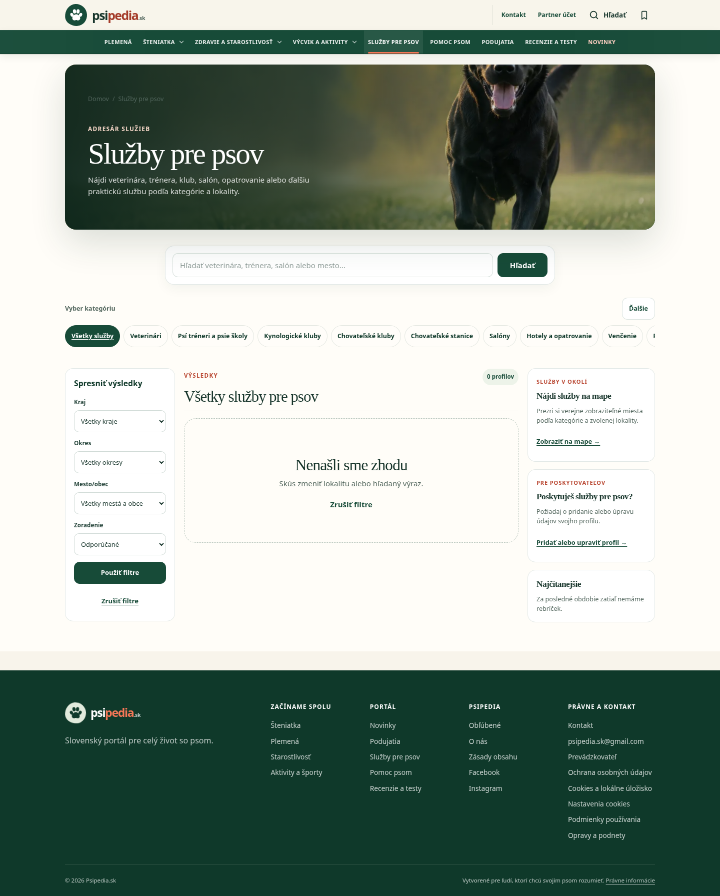
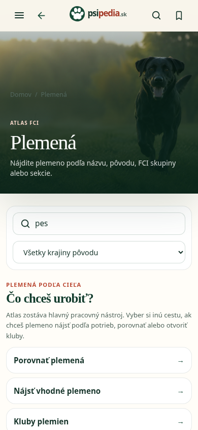
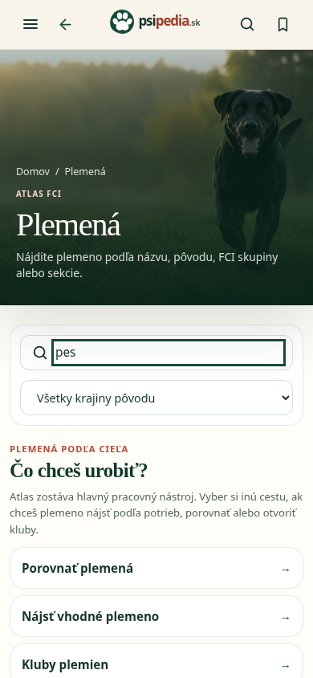

# PSIPEDIA-PUBLIC-UX-POLISH-1

Audit a cielená implementácia na main `c2bf62ef125c5b4076d5a8808398fc0b21e09673`,
14. októbra 2026. Otvorené PR na začiatku: žiadne. PR #805, #815 a #813 potvrdené
ako merged a ich zmeny preskúmané. Jeden PR, bez merge alebo Update branch.
Runtime diff: dve existujúce CSS moduly, 22 riadkov.

## Zistenia pred implementáciou

| Priorita | Miesto | Reprodukcia/dôkaz | Rozhodnutie |
|---|---|---|---|
| P1 prístupnosť | Fotografické hero ôsmich landingov | Vnorené `.page-breadcrumbs` preberá tmavú article farbu rgb(82,102,93), hoci hero wrapper je biely. Na fotografii je navigácia slabo čitateľná; hover ju ešte stmaví. | Opravené hero CSS vrátane hover/focus. |
| P1 klávesnica | Atlas plemien | Fokus na `.breed-search-primary input`: outline none/0px, bez box-shadow alebo indikátora na parentoch. | Opravené atlas CSS: 3px forest focus-visible outline. |
| P2 rozostupy | Hero breadcrumbs | Wrapper má 12px odstup, vnorený article nav ešte 28px margin-bottom. Skladajú sa dve spacing pravidlá. | Nulovaný iba vnorený margin, wrapper si zachová odstup. |
| Bez regresie | Landingy a homepage | 45 vykreslení: deväť trás × 320/390/768/1024/1440 px, bez overflow. Mobilné hero x=0, plná šírka, radius=0. | Zachované rozmery/layout. |
| Bez preukázanej regresie | Homepage #815 | Komponenty a selection zachované, relevantné contract testy prešli. Náhľad bez D1 obsahuje prázdne foto-backed sekcie. | Žiadny homepage súbor sa nemení; naplnený produkčný stav neoverený. |
| Limit auditu | Service/event/help detaily | Bez D1 nie sú dostupné naplnené canonical detailové dáta. Prázdne lokálne katalógy nie sú produkčné zistenie. | Žiadne domyslené opravy; ďalšia staging acceptance s dátami. |

## Skutočne opravené nedostatky

[unified-section-hero.module.css](../../components/public-visual-system/unified-section-hero.module.css)
obmedzuje opravu na breadcrumbs v hero. Nav dedí farbu rodiča, takže fotografická
aj svetlá task varianta zostávajú konzistentné. Hover zachová farbu s podčiarknutím;
keyboard focus má currentColor outline. Article breadcrumbs mimo hero sa nemenia.
Rozmery fotografie, nadpisy, URL a odkazy zostávajú rovnaké.

[breed-atlas.module.css](../../app/plemena/breed-atlas.module.css) dopĺňa focus-visible
iba na existujúce vyhľadávacie pole. Nenahrádza filter ani nepridáva ďalší formulár.
Nezavádza nový CSS systém, globálny reset alebo zmenu dátovej logiky.

## Dôkazy pred/po

Presné screenshoty z tejto úlohy, z lokálneho produkčného buildu, otvorené a
vizuálne skontrolované pred prijatím ako dôkaz. Počty v prázdnom adresári nie sú
produkčné dáta. Nepoužité staré screenshoty ani platené produkčné merania.

### 1. Hero na mobile: Zdravie a starostlivosť, 390 px

Pred:

Po:

### 2. Hero na desktope: Služby, 1440 px

Pred:

Po:

### 3. Focus atlasa: 390 px

Pred:

Po:

## Priechod auditu a zdravie krokov

| Krok | Povrch | Výsledok a hranice |
|---|---|---|
| 1 | Homepage | Päť šírok bez overflow, homepage zdroje nezmenené. Naplnená magazínová sekcia bez live dát neoverená. |
| 2 | Plemená, Šteniatka, Zdravie a starostlivosť, Výcvik a aktivity, Služby, Podujatia, Pomoc psom, Recenzie | HTTP 200; rovnaké H1/titulky/odkazy/input wiring a hero bounds pred/po; 0px overflow na všetkých šírkach. Breadcrumbs a atlas focus opravené. Ostatné indikátory zachované, vrátane parent focus-within na event search. |
| 3 | Článok/plemeno a katalógy/form-entry | Vykreslené `/starostlivost/kedy-ist-so-psom-k-veterinarovi`, `/plemena/australsky-ovciak`, `/adresar/veterinari`, `/pomoc-psom/adopcia`, `/podujatia/pridat-podujatie` na piatich šírkach: HTTP 200 a 0px overflow. Článok a plemeno vizuálne skontrolované, dizajn nezmenený. Posledné tri sú katalógy/vstup do formulára, nie dôkaz naplnených detailov alebo úspešného submitu. |
| 4 | Klávesnica, accessibility a SSR | Tab/Shift+Tab, hover/focus breadcrumbs a funkčné atlas filtrovanie overené. Axe na 12 dostupných stránkach bez violations v zvolenej sade; incomplete výsledky vyžadujú manuálne posúdenie. Jedenásť stránok vracia metadata/obsah aj bez JS. |

Na relevantných landingoch zostáva jedno hlavné vyhľadávanie; atlas používa
existujúci client filter. Interný scroll karuselov/dlaždíc sa nepovažuje za
pretekanie dokumentu. Kalendár, sort, mapové odkazy a CTA neboli prepisované.

## Výsledky testov

- `npm run build`: prešiel pred/po, vrátane artifact validation a jeho 14 vstavaných
  breed testov. Žiadny deploy.
- 65 existujúcich relevantných testov: global design, homepage magazine, unified
  hero, section hero, landing alignment a public CSS scope — prešli.
- [public-ux-polish.spec.ts](../../tests/e2e/public-ux-polish.spec.ts): 10 Playwright
  testov pri piatich šírkach, osem landingov v každom viewport teste plus keyboard
  focus/filter atlasa. Lokálny produkčný náhľad, systémový Chromium: prešli.
  Spec bol spustený cielene; v tomto PR sa nemení CI workflow ani required check.
- [Responsive výsledky](public-ux-polish-1/responsive-results.json): 45 porovnaní,
  rovnaké title/H1/links/inputs/hero bounds a bez overflow.
- [Axe výsledky](public-ux-polish-1/accessibility.json): 12 stránok, 0 violations
  v wcag2a/wcag2aa sade. Nie je to úplná WCAG certifikácia ani všetky UI stavy.
- [SSR výsledky](public-ux-polish-1/ssr.json): 11 stránok bez JavaScriptu, H1/title/
  description/canonical aj obsah server-rendered. SEO/page TSX súbory sa nemenia.
- TypeScript `tsc --noEmit --incremental false` neprešiel na existujúcom baseline:
  1 908 diagnostík pred aj po, 0 pridaných/odstránených, vrátane chýbajúcich
  Cloudflare/D1 typov. Nový E2E spec nepridal diagnostiky.
- Lint `npm run lint -- --ignore-pattern outputs`: 0 errors, 95 existujúcich warnings.
  Pôvodný beh zachytil 17 errors iba v starom ignorovanom lokálnom React bundle
  `outputs/redesign4/preview.js`. Auditné výstupy sa necommitujú, lint konfigurácia
  zostáva rovnaká. Oprava baseline type setupu nepatrí do vizuálneho PR.

## Mimo PR a nasledujúca acceptance

Produkcia bola neprístupná cez sieťový CONNECT (HTTP 403). Použitý bol aktuálny
lokálny produkčný build na porte 5181, s náhľadovou konfiguráciou v ignorovanom
dist bez D1 bindingu/cron triggerov. Repository/produkčná konfigurácia nezmenená.
Google Maps requesty boli v auditnom capture blokované, analytika odmietnutá.
Žiadne D1 migrácie ani Notion/Gemini/Google zápisy.

Samostatná staging acceptance s publikovanými service/event/help dátami môže
overiť naplnenú homepage, detailové fotografie/sidebary a formulárové validation/
submit stavy. Toto sú neoverené oblasti, nie zoznam potvrdených chýb. Ďalšia
technická úloha môže riešiť TypeScript baseline. Žiadna z nich sa tu nespúšťa.
Homepage, CMS, dátové write/sync cesty, SEO, URL, platby a produkčné merania sú
mimo tohto PR.
