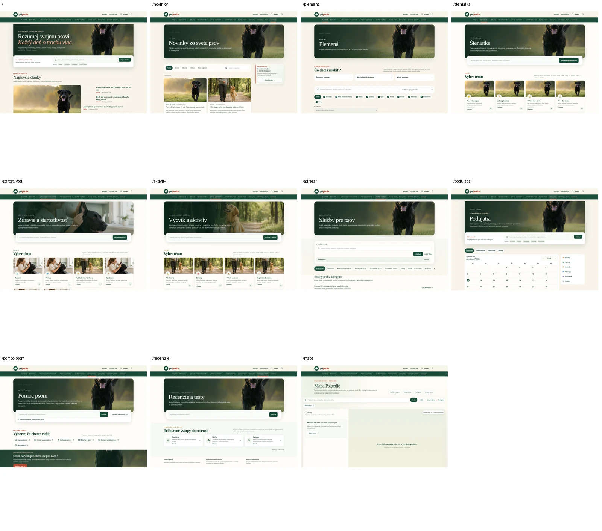
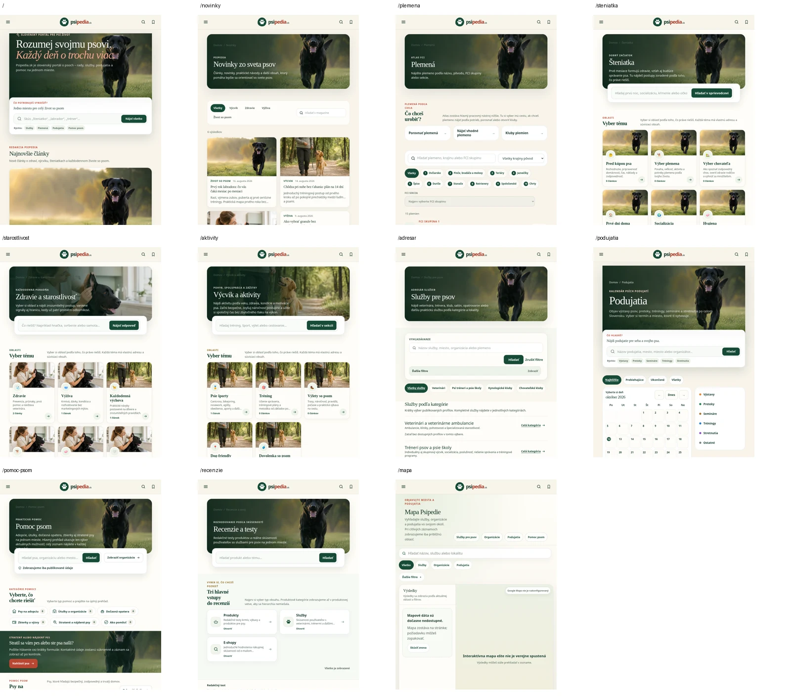
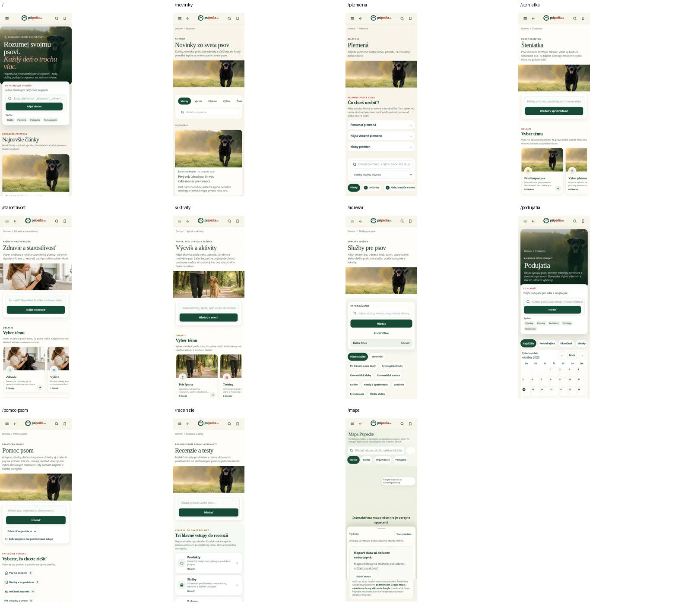
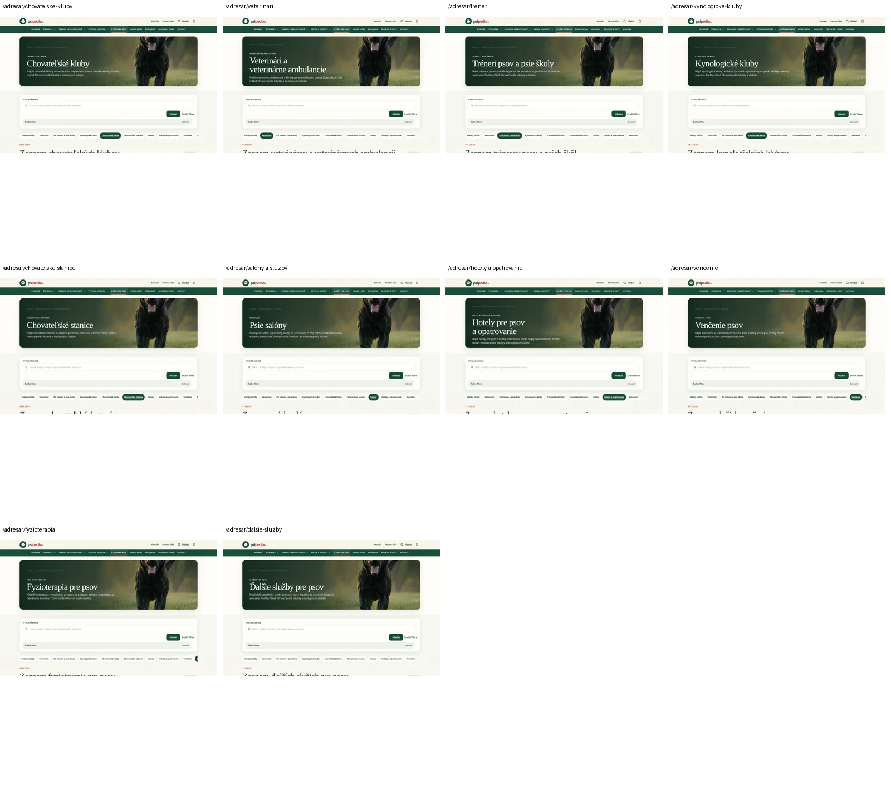
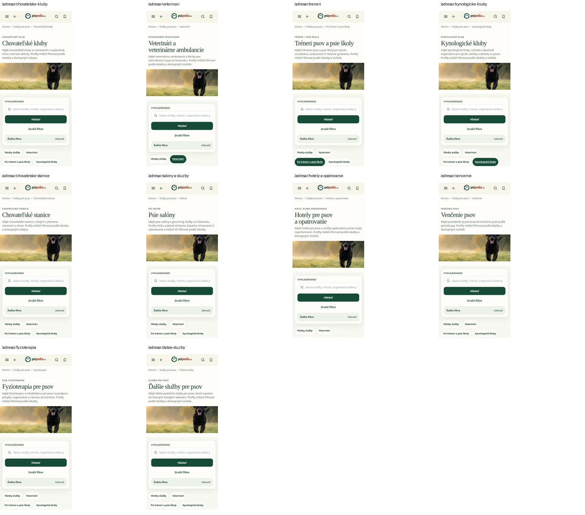
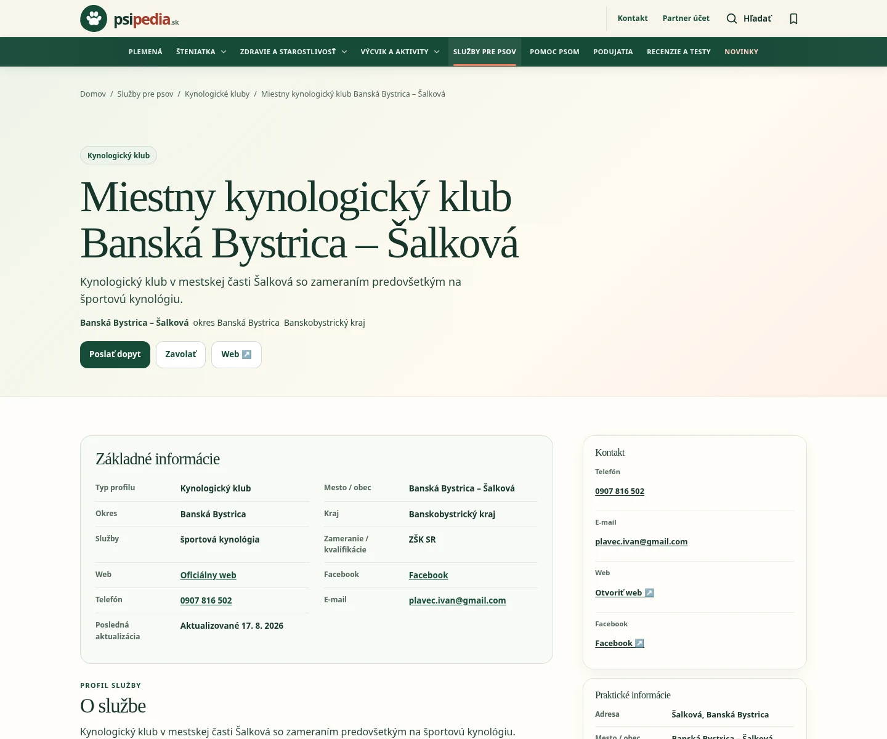

# PSIPEDIA-SERVICES-V2 — fáza 1/10

## 1. Rozsah, stav a dôkazy

Audit z 12. 10. 2026. Referencia: homepage. **Iba dokumentácia, žiadna implementácia roadmapy.**

- Aktuálny main bol načítaný cez `git fetch origin main`: **`5e4c249e048574a4fd1e889f6715a6d920a130d5`**. Auditná vetva `docs/psipedia-services-v2-phase1-audit` vznikla priamo z neho. Fáza Podujatí 5/5 už je v tomto main; staré screenshoty ani čísla z nej nie sú dôkazmi tohto auditu.
- Projekt: App Router routy v `app/`, React komponenty v `components/`, store/SEO/sync v `lib/`, Cloudflare Worker v `worker/index.ts`, D1 migrácie v `drizzle/`, verejné obrázky v `public/`, testy v `tests/`, scoped CI v `.github/workflows/`. Next kompatibilné API beží cez Vite/Vinext a Wrangler, nie štandardný Next server. Node 24, existujúci lockfile a toolchain.
- Otvorené [PR #762](https://github.com/investradarsk/psipedia-sk/pull/762), `feat/image-editor-2-universal-center-guides`: univerzálny obrazový editor, admin adresára, DirectoryCard/DirectoryProfileDetail, EventImage/EventCard/EventDetail a ďalšie verejné médiá. **Prebiehajúca implementácia, priame konfliktné plochy pre fázy 2, 3 a 5.** Nevytvárať druhý editor ani nový crop kontrakt.
- Otvorené [PR #763](https://github.com/investradarsk/psipedia-sk/pull/763), `fix/production-e2e-home-events-20261012`: zmena `tests/e2e/psipedia.spec.ts`. Závislosť finálnej akceptácie; nevychádzať zo starých selektorov. Stav PR bol overený na začiatku auditu, nie je to sľub budúceho stavu.

**Značenie:** **P** = potvrdené zdrojom alebo aktuálnym lokálnym meraním; **R** = odporúčanie, zatiaľ neimplementované; **N** = neoverené na produkcii/živých dátach; **B** = blokujúca závislosť pred príslušnou budúcou implementáciou. P pri zdrojovom kontrakte neznamená potvrdenú kvalitu alebo úplnosť produkčných dát.

### Metóda a limity

Vizuálna časť použila postup product-design:audit: aktuálne screenshoty pred hodnotením, uloženie a kontrola zachytených obrazoviek. Chromium `/usr/bin/chromium`, aktuálny produkčný build, lokálny Wrangler. **Produkčný HTTPS prístup skončil 403 na CONNECT/prístupovej vrstve (envoy); nie aplikačným 403.** Nasadený SHA, živé crops, produkčné CWV, vzdialený D1 a živá Notion schéma zostávajú N.

Existujúca lokálna D1 má 248 publikovaných kynologických klubov, 0 podujatí a 0 riadkov sekčných nastavenie. Nie je reprezentatívnym produkčným datasetom. Prvý priechod s týmto bindingom mal pri viacerých sekciách 404 kvôli chýbajúcim nastaveniam; tieto stavy **nie sú hlásené ako produkčné chyby**. Následný hlavný vizuálny priechod použil rovnaký produkčný artefakt s **vynechaným D1 bindingom v generovanej ignorovanej lokálnej konfigurácii**. App použila existujúce fallback sekcie, predvolené obrázky/orezy a seed články, bez dopĺňania databázy. Nie je to nový template ani statická napodobenina aplikácie.

Zachytených 76 unikátnych vstupných URL × 3 viewporty = 228 snímok. Rozmery **1440×900, 768×900, 390×844**. Pokryté všetky hlavné sekcie, ich definované podstránky a 10 kategórií adresára; inventár nižšie. Chybne pridaná auditná skúšobná URL `/podujatia/ostatne` vrátila 404, nejde o existujúcu kategóriu. Správny zdrojový kontrakt je `/podujatia/dalsie`; overený samostatne. Prvé 404 snímky a neplatná skúšobná URL nie sú akceptované dizajnové dôkazy. Na úspešných snímkach bez page errors a bez horizontálneho overflow pri týchto šírkach. Screenshoty samy nepotvrdzujú WCAG ani funkčnú správnosť všetkých filtrov.

Súhrnné výrezy sú dokumentačné montáže aktuálnych snímok, nie nové návrhy:

Podkategórie: [1](services-v2-phase1-evidence/subcategories-1.webp), [2](services-v2-phase1-evidence/subcategories-2.webp), [3](services-v2-phase1-evidence/subcategories-3.webp), [4](services-v2-phase1-evidence/subcategories-4.webp), [5](services-v2-phase1-evidence/subcategories-5.webp). Originály a surové lokálne záznamy: ignorované `outputs/services-v2-phase1/`, `capture.json`, `measure.json`, `sql.json`, `local-directory.json`. Dôležité agregované dôkazy sú uložené pri tomto dokumente, aby PR nezáviselo iba od lokálnych výstupov.

## 2. Spoločné šírky a vizuálne odchýlky

**P:** [app/design-system.css](../../app/design-system.css), `:root` a `.page-container/.public-shell`: `--ps-content-max:1180px`; [app/globals.css](../../app/globals.css), `.shell`: `width:min(1180px,calc(100% - 48px))`. Token je na verejných kontajneroch použitý ako `max-width`, ale zdroj šírky stále duplikuje literal 1180. Ak sa neskôr zmení iba token, `.shell` môže zostať na starej hodnote. [PageContainer](../../components/page-system.tsx) pridáva všetky tri triedy `shell public-shell page-container`; nezavádzať ďalší kontajner.

Meranie DOM vyberalo samotný `[data-unified-section-hero-visual]`, nie vonkajší shell ani hlavičku. Na 1440 px mali hlavné hero šírku 1180 a x=130; na 768 px typicky šírku 720. Mobile nie je jednotný: homepage hero 390/x=0, Podujatia 366/x=12, adresár 366/x=12, Starostlivosť 358/x=16. `.public-shell` má mobilný gutter 12, ďalšie sekčné pravidlá a homepage full-bleed ho menia. Rozdiely sú potvrdené meraním; nemusí ísť o chybu každej individuálnej obrazovky.

| Stránka / skupina | Komponent a problém voči homepage | Príčina / dôkaz | Riešenie pre ďalšiu fázu |
|---|---|---|---|
| Homepage `/` | Referencia: desktop 1180×330, radius 0, copy 36/0/42/46; mobil text na fotke, radius 20 a full-bleed | [app/page.tsx](../../app/page.tsx), `data-home-hero`; [home-v2.module.css](../../app/home-v2.module.css), `.hero-card` a mobile pravidlá | Centrálne zachytiť tento **aktuálny** kontrakt, nie starší globálny `.hero-card` |
| `/novinky` | Desktop 330/radius24/copy44×48, mobil text nad samostatným obrázkom | `UnifiedSectionHero` default; [app/novinky/page.tsx](../../app/[section]/page.tsx) | Zjednotiť hero variant podľa homepage; zachovať archív a search |
| `/plemena` | Rovnaká odchýlka radius24/split mobile; atlas a filter majú vlastnú hustotu | [app/plemena/page.tsx](../../app/plemena/page.tsx), spoločný hero | Zdieľaný hero, atlasové filtre zostávajú špecifické |
| `/steniatka`, `/starostlivost`, `/aktivity`, `/recenzie` | Desktop visual330, ale shell449 kvôli tools a padding; split mobile, rozdielne gutters | [app/[section]/page.tsx](../../app/[section]/page.tsx), [portal-sections](../../components/portal-hub.tsx), shared hero/tools | Rozlišovať výšku fotografie, tools a celého hero bloku; jeden centrálny variant a spacing |
| Ich obsahové podstránky | Shared hero, navigácia, niekde guide/promos; odlišná typografická hierarchia od landing | [app/[section]/[slug]/page.tsx](../../app/[section]/[slug]/page.tsx), komponenty portal topic | Jeden hero kontrakt, obsahové šablóny nezlievať do adresára |
| Novinkové archívy | Textový hlavičkový blok bez fotografie; nie rovnaké hero ako root | [components/news-category-page.tsx](../../components/news-hub.tsx) | Rozhodnúť vedomý `compact/archive` variant; nevynucovať fotografiu pre každý archív |
| `/adresar` + všetkých 10 kategórií | Radius24/split mobile; search je samostatný vysoký toolbar, nie pole+tlačidlo v tools. Root navyše category overview | [DirectoryPage](../../components/directory-page.tsx), `showRootOverview`; [DirectoryFilterForm](../../components/directory-filter-form.tsx) | Jeden template root/category; search rozdeliť od sidebar filtrov, bez druhého search systému |
| `/adresar/veterinari` | Pri predvolenom desktop texte DOM copy351.64 presahuje visual330; riziko odrezania dlhého intro | `.copy` grid + padding44×48 v fixed-height/overflow-hidden visual; desktop kategóriová snímka | Pred fixovaním výšok otestovať dlhý title/intro a text zoom; jedno centrálne pravidlo pre obsahový overflow |
| `/podujatia` | Najbližšie homepage:330/radius0, mobile overlay/radius20; shell má18/0 namiesto22/32 | [events-public.module.css](../../components/events-public.module.css), `.homeHeroShell`, `.homeHero`, selektory `data-unified-section-hero-*` | Preniesť overené správanie do centrálneho hero variantu; odstrániť lokálne overrides až po parity testoch |
| `/podujatia/vystavy`, `/preteky`, `/seminare`, `/treningy`, `/stretnutia`, `/dalsie` | Kategórie používajú shared default, nie hlavný `homeHero` variant | [EventsPage](../../components/events-page.tsx), `isMainListing` a výber tried | Uplatniť centrálny variant aj na podkategórie; zachovať filtre a individuálny hero key |
| `/pomoc-psom` a podkategórie | Desktop shared radius24, viac CTA/meta v tools; split mobile | [components/help-overview.tsx](../../components/help-overview.tsx), [app/pomoc-psom/page.tsx](../../app/pomoc-psom/page.tsx) | Hero variant oddeliť od náročnej help navigácie/CTA |
| `/mapa` | Nie fotografický hero: pracovná mapa, vlastné ovládanie a mobilný sheet | [MapExperience](../../components/map/map-experience.tsx), [map-public.module.css](../../components/map/map-public.module.css) | Zachovať pracovný mapový layout ako výnimku; spoločné tokens/typografia, nie 330px foto nad mapou |
| Porovnanie plemien, výber plemena, pridanie podujatia, tip redakcii | Úlohové/formulárové hlavičky, nie marketingové landing hero | Príslušné dedikované routy a `PageContainer` | Zdieľať šírku a control tokens, neprepisovať ich na fototemplate bez UX dôvodu |

**P:** karta/tlačidlo/typografia majú spoločný základ v `design-system.css`, `PublicFoundation` a `PublicDataCard`, ale paralelne existujú globálne `directory-*`, lokálny `directory-public.module.css`, `directory-filter-form.module.css`, starší `SectionHero/PublicSectionHeader` a nový `UnifiedSectionHero`. [public-visual-system.module.css](../../components/public-visual-system/public-visual-system.module.css) definuje card radius16 a body .9375rem, shared hero má radius24/tools18, homepage mobile20. [directory-public.module.css](../../components/directory-public.module.css) obsahuje mnoho postupných úprav; neoznačujeme každé starší pravidlo za mŕtve bez coverage. Globálny CSS súbor obsahuje aj veľa admin pravidiel. R: rozdeliť vlastníctvo tokenov a merať reálne použitý CSS, nie naslepo mazať.

### Krokový UX/a11y prehľad

1. **Vstup na homepage/sekciu — použiteľný, vizuálne nejednotný.** Spoločné logo, farby a serif nadpisy; rozdielny radius, mobile split/overlay, gutter a tools. Predvolený crop psa niekde odreže hlavu; N, či produkčný administrátor má iné crops. Neprepisovať obrázok, preveriť uložený orez a preview pomer.
2. **Vyhľadávanie a kategória — existujúca funkcia, treba zjednodušiť rozloženie.** Directory search má label a GET; navigácia kategórií zdieľaná. Desktop posledné chips sú v horizontálnom tracku; mobil sa wrapuje. R: „Ďalšie“ s jasným rozbalením a klávesnicou, nie skrytý overflow bez affordance.
3. **Filtre/výsledky — dobrý SQL/URL základ, dátovo obmedzené.** Niektoré filtre sa zobrazia iba pri dostupných options; služby sú voľné texty. No-JS/klávesnica/zoom celého nového trojstĺpca musí mať samostatné akceptačné testy. Screenshot nie je takýto test.
4. **Profil a mapa — existujúce komponenty, živá dátová presnosť N.** GEO rozlišuje presnú a približnú polohu; súhlas a konfigurácia sú podmienkou SDK. Disabled mapa je zachytený lokálny stav, nie dôkaz produkčného výpadku.
5. **Návrat a stránkovanie — stabilný zdrojový kontrakt, produkčná akceptácia N.** DirectoryResults zachováva query pri pagination; EventsBackLink/RememberEventsListing zachováva návratový stav. Preniesť kontrakt bez kopírovania event parametrov do služieb.

## 3. Hero systém a administrácia

**P:** [UnifiedSectionHero/Shell](../../components/public-visual-system/unified-section-hero.tsx) je server komponent. Shell používa PageContainer. Hero prijíma `ResolvedSectionVisual`, nastaví samostatné desktop/mobile CSS premenné x/y/zoom, managed title/eyebrow/intro, search/CTA/meta/quickLinks. [unified-section-hero.module.css](../../components/public-visual-system/unified-section-hero.module.css): default visual `height:clamp(260px,24vw,330px)`, radius24, copy `min(720px,64%)`, padding clamp28–44/28–48; do767 mobile split, full-width media16:6, radius0; do430 search button pod poľom. Home má osobný globálny markup a scoped overrides; Podujatia používajú tento komponent plus selektory, ktoré jeho mobile split znova prepisujú na overlay. **To je konkrétna príčina rôznych zaoblení, nie nekonzistentný obrázkový súbor.**

[section-visual-contract.ts](../../lib/section-visual-contract.ts): keys `home.hero`, `section.*`, `directory.*`, `events.*`, typy homepage/section/subsection/directory/events/help/reviews; desktop preview16:7, mobile16:6, recommended2000×900/min1600×720, zoom1–3. [section-visual-store.ts](../../lib/section-visual-store.ts): `section_visuals`, fallback definície a `getSectionHeroVisual`, napojenie na managed hero copy. [admin-section-visuals.tsx](../../components/admin-section-visuals.tsx) a príslušné admin API spravujú image/alt/crop; nejde o editor samotného obrazového obsahu.

**R: centrálne riešenie:** rozšíriť existujúci UnifiedSectionHero o explicitné prezentačné varianty `homepage-style`, `compact/archive`, prípadne `task`, bez nového renderera. Jeden vlastník šírky/gutter, radius, copy, výšky a tools. Homepage a Podujatia migrovať na variant po screenshot parity, potom ostatné sekcie. Default desktop radius0 a mobile20/overlay odvodiť z homepage; vedomé compact/task výnimky zdokumentovať. Žiadne nové lokálne `!important` alebo globálne zásahy na admin.

**B:** aktuálne preview16:7 a CSS vizuál1180×330 (~3.58:1) nie sú rovnaký pomer. Budúca zmena pomerov musí aktualizovať preview význam crops, inak sa x/y/zoom síce zachovajú, ale výsledný orez sa zmení. Pred migráciou export/read-only inventár reálnych section_visuals a kontrola screenshotov pri stored crop0/1, zoom1/3 a dlhom title. Zachovať imageUrl/key/alt aj desktop/mobile crop; žiadne prepisovanie, generovanie alebo obsahová editácia obrázkov. Koordinovať #762.

## 4. Podujatia ako UX vzor a reuse

| Existujúci prvok | Použiť v adresári | Hranica reuse / zdroj |
|---|---|---|
| `UnifiedSectionHero`, `UnifiedSectionHeroShell`, `PageContainer`, `PublicFoundation`, `PublicContentShell` | Áno, základ template | [public-visual-system](../../components/public-visual-system/index.ts), centrálna prezentácia z časti3 |
| `SectionHeroSearch` | Áno, jednoduché pole+tlačidlo a hidden stav | [section-hero-search.tsx](../../components/section-hero-search.tsx); directory query keys zachovať, nevytvárať nový fulltext engine |
| `PublicSubcategoryNavigator` compact | Áno, všetky služby+10 kategórií+„Ďalšie“ | [public-subcategory-navigator.tsx](../../components/public-visual-system/public-subcategory-navigator.tsx), current/aria label; už použitý v DirectoryPage |
| Sidebar disclosure, GET query, active chips, scroll-margin vzor | Princíp áno | [event-listing-results.tsx](../../components/event-listing-results.tsx); neimportovať EventType ani event dátumové parametre do directory |
| `PublicFilterDisclosure` | Možný zdieľaný primitive | [public-filter-disclosure.tsx](../../components/public-filter-disclosure.tsx); teraz používaný DirectoryFilterForm, auditovať focus/no-JS pred zmenou |
| `DirectoryCard`, `SmartCardImage`, `DirectoryProfileDetail` | Zachovať, vylepšiť iba scoped presentation | [directory-card.tsx](../../components/directory-card.tsx); whole-link, lazy media, source-specific modes; #762 mení tieto súbory |
| Pagination URL kontrakt | Zachovať existujúci directory | [DirectoryResults.pageHref](../../components/directory-results.tsx), q/category/region/district/city/service/breed/fci/organization/type/sort/page |
| Event calendar, day counts, event fallback typy | Nie | Odlišná doména; nie sú službové filtre ani directory ikony |
| `PublicContextBanner` a partner management state | Áno, pravý stĺpec CTA | [public-context-banner.tsx](../../components/public-visual-system/public-context-banner.tsx), [partner-public-profile.ts](../../lib/partner-public-profile.ts); nepremeniť root kontakt na neoprávnený priamy edit |

**P:** Podujatia majú jednoduchý hero search, typové odkazy, ľavé filtre a karty po12, URL parser a SEO. Pravá legenda je doplnok kalendára, **nie univerzálny trojstĺpcový sidebar výsledkov**. Directory má 24/page, nie12; zmena počte je produktová/performance voľba, nie povinný reuse. Budúci template má použiť shared primitives, ale súčasný event store ani calendar nemeniť.

## 5. Aktuálny adresár a budúci template

**P:** [app/adresar/page.tsx](../../app/adresar/page.tsx) načíta paralelne listing, counts a na čistom root category previews7. [app/adresar/[category]/page.tsx](../../app/adresar/[category]/page.tsx) používa tú istú DirectoryPage, vlastný category visual key a canonical category title/intro. Root bez filtrov/page1 skryje jednu výsledkovú mriežku a zobrazí `DirectoryCategoryOverview`; category má výsledky. To je najväčšia súčasná odchýlka od schváleného jednotného template.

**R:** hero → jednoduché search pole a submit → horizontálna category navigácia → grid **ľavé filtre / stredné profily / pravé doplnky**. Jeden DirectoryPage bez alternativnej root architektúry; category mení dáta, active nav, hero content/key a definície filtrov. Zachovať profile href/category params a dostupné súvisiace články. Search/filters je možné mať v oddelených GET formulároch, ale oba musia niesť hidden stav ostatných filtrov, resetovať page a zachovať sort. Query nebudovať dvomi rozdielnymi serializérmi; vyťažiť súčasný parseDirectoryFilters/pageHref do jedného kontraktu. Je to budúca úloha, v audite nič neextrahované.

Základné filtre už existujú: region/district/city, category a profileType. **Typ služby** treba jednoznačne rozlíšiť od hlavných kategórií: na root category=10 hlavných skupín; type=vnútrokategóriový kontrolovaný typ. Aktuálny `profileType` z JSON `Typ služby/Typ poskytovateľa/Typ klubu` tieto významy mieša. `service` je presná voľná položka services_json. Nenahrádzať to jedným univerzálnym free-text filtrom.

Existujúca lokalitná hierarchia: [slovakia-locations.ts](../../lib/slovakia-locations.ts), 8 krajov/79 okresov a obce; [SlovakiaLocationSelector](../../components/slovakia-location-selector.tsx). Public options sa dnes odvodzujú iba z publikovaných profilov; D1 district môže fallbackovať na importovaný `Okres`, region podporuje tvar s/bez „kraj“. R: centrálna normalizácia, nezamieňať chýbajúcu obec za neexistujúcu službu. Poloha používateľa je samostatná budúca opt-in funkcia: vysvetlenie účelu, odmietnutie bez blokovania, manuálny filter vždy dostupný, geolocation len po akcii, presné provider body nezamieňať za služobné oblasti. Bez automatických platených geocoding/Places volaní pri každom filtrovaní.

## 6. Matica dát a kategóriových filtrov

**P:** [directory.ts](../../lib/directory.ts) má10 hlavných kategórií a2 legacy; [directory-store.ts](../../lib/directory-store.ts), `DirectoryFilters`, `DIRECTORY_SOURCE_FACETS`, `listPublishedDirectoryProfiles`: q/category/region/district/city/service/breed/fciGroup/organization/profileType/sort/page. `services_json` je štruktúrované pole **voľných stringov**, nie schválený enum. Špecifické fakty sú v `source_data_json` a čítajú sa cez [directory-detail-presentation.ts.detailFields/importedValue](../../lib/directory-detail-presentation.ts); existencia názvu v tomto kóde nedokazuje vyplnenosť, konzistenciu alebo sync do živého Notion.

**S** = existujúci štruktúrovaný stĺpec/zoznam/relation, ale môže potrebovať normalizáciu; **T** = importovaný text/JSON, nespoľahlivý ako riadený filter; **Pj** = nový kanonický údaj/projekcia (možno v existujúcom JSON, nejde automaticky o nový SQL stĺpec). „A/N/?“ znamená áno/nie/neznáme; nevyplnené nikdy neprevádzať na nie. Nasledujúce riadené hodnoty sú **R**, nie zistená živá Notion schéma. Všetky booleanové kandidáty vyžadujú Pj a potvrdenie zdroja pred zapnutím verejného filtra.

| Kategória, URL | Kandidáti filtrov a navrhovaný typ/hodnoty | Súčasný zdroj a spoľahlivosť | Stav / podmienka verejného filtra |
|---|---|---|---|
| Veterinári `/adresar/veterinari` | Špecializácie `enum[]` (napr. interná medicína/chirurgia/dermatológia/stomatológia, finálny slovník schváliť); Pohotovosť/Hospitalizácia/RTG/USG/Laboratórium `A/N/?` | T rovnomenné detailFields; S services_json je voľný text | Pj: veterinárne služby a tri-state; pohotovosť navyše presné podmienky/čas a overenie, samotný text „pohotovosť“ negarantuje24/7 |
| Tréneri `/adresar/treneri` | Individuálny/skupinový výcvik/výcvik šteniat/behaviorálne poradenstvo/online konzultácie `A/N/?`; zameranie `enum[]` | T importované flags; S services_json voľný zoznam | Pj po schválení explicitných id a normalizácii, bez sľubu odborného kvalitatívneho hodnotenia |
| Kynologické kluby `/adresar/kynologicke-kluby` | Typ klubu `enum` (miestny/športový/záujmový, schváliť); organizácia `enum/string-id`; disciplíny `enum[]` (sport/obrany/stopy/agility/rally/retriever-poľovníctvo); individuálny/skupinový/šteňatá `A/N/?` | T Typ klubu/Zameranie/Organizácia/Športová kynológia/Obrany/Stopy/Agility/Rally obedience/Retriever…; S services_json; relation organizácie potrebuje kontrolu | Pj; existujúce24/page name-asc klubové pomocné typy nie sú dôvod na druhý template |
| Chovateľské kluby `/adresar/chovatelske-kluby` | Plemená `breed-id[]`; FCI skupiny1–10 + explicitná non-FCI hodnota; zastrešujúca organizácia `organization-id` | S `breed_directory_relations` je vhodnejší než text; T Plemeno/Plemená/FCI/Organizácia/Zastrešujúca organizácia | Plemeno cez existujúce relation po audite pokrytia; viacplemenný import sa dnes porovnáva ako celý string, nemožno ho považovať za multi-select |
| Chovateľské stanice `/adresar/chovatelske-stanice` | Plemená/FCI/klub ako vyššie; aktívny chov `A/N/?`; aktuálne/plánované vrhy cez prepojený publikovaný vrh a čas | T Chovateľ/Klub/Aktívny chov/Aktuálne vrhy/Plánované vrhy; S breed relation, dostupný puppy doménový model vyžaduje overené prepojenie | Pj aktívny chov; vrhy **neaktivovať z voľného textu** bez dátumu/TTL a relation. Chovateľovo meno nie je filter kvality |
| Salóny `/adresar/salony-a-sluzby` | Služby `enum[]`: strihanie/kúpanie/trimovanie/vyčesávanie; mobilná služba `A/N/?` len po získaní údaja | S services_json voľný text. `detailFields` nemá samostatnú salónovú riadenú mapu; zmienka v hero nie je dátové pole | Pj službový enum. Veľkosť psa/typ srsti nenavrhovať ako dostupný filter bez nových spoľahlivých údajov |
| Hotely `/adresar/hotely-a-opatrovanie` | Hotel/opatrovanie/denná starostlivosť/vyzdvihnutie/online objednanie `A/N/?` | T rovnomenné flags; S services_json | Pj. Typ zariadenia a typ služby môžu byť multi, neobmedziť profil na jeden nesprávny typ |
| Venčenie `/adresar/vencenie` | Individuálne/skupinové/s tréningom/šteňatá/veľké psy/seniori-špeciálne potreby/vyzdvihnutie/GPS-foto-report `A/N/?`; typ poskytovateľa `enum` (osoba/firma, schváliť) | T rovnomenné detailFields a Typ poskytovateľa; S services_json | Pj; GPS/foto údaj nie je oprávnenie sledovať polohu používateľa |
| Fyzioterapia `/adresar/fyzioterapia` | Metódy `enum[]`: hydro/laser/magnet/elektro/manuálne/dogfitness; indikácie `enum[]`: pooperačná/ortopedická/neurologická/športové-pracovné psy; mobilná služba `A/N/?` | T rovnomenné flags, Odborník/certifikácia; S services_json/qualifications_json voľný text | Pj, certifikáciu zobrazovať ako doložený fakt, nie ako verejný score alebo automatické odborné overenie |
| Ďalšie `/adresar/dalsie-sluzby` | Typ služby `enum` po inventári reálnych dát; výjazd/celoslovenská dostupnosť `A/N/?`; pokrytie `region/district-id[]` | T Typ služby/Pokrytie/Výjazd ku klientovi/Celoslovenská dostupnosť/Orientačná cena | Pj; cena ostáva voľný text, cenový slider bez jednotky/mena/dátumu nie je dátovo podporený |

### Jeden centrálny slovník: návrh kontraktu

R: jeden budúci `lib/directory-filter-contract.ts`, importovaný editorom, partner formulárom, server validátorom, Notion adaptérom aj public query parserom. Každá definícia: stabilné id, categoryIds, label, valueType, allowedValues s id/label, unknown policy, public param, D1 path/projection, legacy source aliases, Notion property/type, schemaVersion. UI label nie je storage id. Slovník iba opisuje podporované údaje; importovaný alebo neoverený filter nezobrazovať ako hotovú funkcionalitu.

| Filter/skupina | Typ / povolené hodnoty R | D1 dnes → navrhované uloženie | Notion mapovanie dnes → návrh (živé N) | Zdroj, migrácia a konflikt |
|---|---|---|---|---|
| Kraj | region-id /8 oficiálnych krajov | region TEXT → zachovať, normalizovať cez spoločný registry | `Kraj` rich_text → zachovať výstup label; riadený id odvodiť v adaptéri | S; dry-run aliasy „kraj“/bez, nič nehromadne prepisovať bez review |
| Okres | district-id /79 okresov viazaných na kraj | district TEXT + JSON Okres fallback → kanonická projekcia, pôvodný text zachovaný | `Okres` rich_text | S/T; obec/okres konflikty do review, nie tiché vynulovanie |
| Mesto/obec | municipality-id viazané na okres | city TEXT → normalizovaný id v projection; city ponechať | `Mesto` rich_text | S; homonymné obce rozlišovať okresom, zahraničné/online explicitne mimo SK hierarchie |
| Hlavná kategória | enum10 kanonických slugov, legacy explicitne | category TEXT nezmeniť URL | `Kategória` rich_text | S; presmerovania a legacy profiles nesmú zaniknúť |
| Typ služby | vnútrokategóriové enum[] schválené z inventára | T importované typy → `_psipedia_service_facets.types` | dnes bez riadeného snapshot poľa → nové riadené property/type až po potvrdení schémy | T/Pj; názvy Typ služby/poskytovateľa/klubu sa nesmú zlievať bez category |
| Služby/metódy/indikácie | enum[] id, uvedené per-category | services_json zachovať; `_psipedia_service_facets` kanonický namespace/version | `Služby` dnes rich_text s newline, nie multi_select → navrhnúť riadené kategóriové multi_select až po schema approval | S/T/Pj; parser presných aliasov, neznámy string zachovať iba ako text, neodhadovať regexom z popisu |
| Každý A/N/? flag v matici | enum YES/NO/UNKNOWN, nullable nie „missing=false“ | starý rovnomenný source_data_json kľúč zachovať; typed value v namespace | budúci select Áno/Nie/Neoverené alebo checkbox **plus samostatný známy/overený stav**; samotný checkbox nestačí | T/Pj; tri-state parse explicitných zdrojov, dátum/provenance, žiadna automatická medical/service pravda |
| Plemeno | breed-id[] canonical atlas id | `breed_directory_relations` → preferovať relation; JSON pôvodné Plemeno/Plemená ponechať | dnes Plemeno/Plemená nie je v `EditableDirectorySnapshot`; budúce relation/multi_select s mapou id | S/T; aliasy a viacplemenné hodnoty manuálne overiť, hash snapshot rozšíriť |
| FCI skupina | 1–10 + NON_FCI/UNKNOWN | relation atlas → odvodiť, JSON text ponechať | importované FCI/FCI skupina nie v sync snapshot; budúci select/multi_select | T/Pj; nezamieňať FCI a organizáciu, neklasifikovať neznáme na non-FCI |
| Organizácia/klub | registry id + display label, UNKNOWN | importované Organizácia/Zastrešujúca organizácia/Klub → explicitná kanonická projekcia | teraz mimo riadeného directory snapshotu; budúci select/relation po live schéme | T/Pj; synonymá a entity matching sa riešia oddelene, nie cez voľné URL |
| Pokrytie | SK region/district ids[] alebo ONLINE/COUNTRYWIDE | pôvodný Pokrytie text ponechať, projection[] | budúci multi_select/registry adaptér; dnes coverage sa číta z textu | T/Pj; nevytvárať presné GEO body zo služobnej oblasti |
| Aktuálne/plánované vrhy | existujúca publikovaná relation + validita dátumu | puppy entity relation, nie nový voľný bool | závisí od puppy sync schémy; zatiaľ N | B: overiť väzbu na stanicu a časovú aktuálnosť, dovtedy filter vypnutý |

Tento návrh uprednostňuje nový verzovaný namespace **v existujúcom** `source_data_json` pre typed dáta a zachovanie pôvodných voľnotextových polí. To je nový dátový kontrakt, hoci nie nevyhnutne nový SQL stĺpec. Pre rýchle indexed query možno neskôr schváliť odvodenú relation/projection tabuľku; rozhodnúť až po profilovaní. V tejto fáze sa nič z toho nevytvára.

**Migračný postup R:** read-only inventár produkčných hodnôt a pokrytia → verzovaný explicitný alias mapping → dry-run počty známych/neznámych/konfliktov → review → dávkový idempotentný backfill iba schválených hodnôt, rollback a audit log → round-trip testy → verejné filtre len pri dostatočne známom pokrytie. Existujúce JSON/description/services/qualifications sa nestrácajú. Neprázdny text „nie je overené“ nie je pozitívna služba. Žiadne nové Notion properties v tomto audite.

**B — kodek a zachovanie dát:** `directory-store.ts.safeImportData` dnes prepúšťa iba string/number/null a odstraňuje interné kľúče z public výstupu. Nested object/array s typed facets sa preto nedá bezpečne iba pridať do importData. Fáza4 musí navrhnúť explicitný validovaný typed codec a bezstratový merge kanonického source JSON; public mapper vystaví iba povolené facet IDs, nikdy celý raw source_data_json. Pred prvým backfillom je povinný test update→save→read, aby sa nový namespace nestratil pri bežnej editácii kontaktu alebo Notion pull. Alternatívu serializovaného JSON stringu v existujúcom flat namespace alebo samostatnú projection rozhodnúť podľa query plánu; obe musia mať jeden kanonický kontrakt, nie súbežné zdroje pravdy.

## 7. Editor ↔ D1 ↔ Notion ↔ partner

**P:** [AdminDirectoryEditor](../../components/admin-directory-editor.tsx), `save`: posiela category, services/qualifications z newline textarea, description/location/contact/image/quality/featured/SEO; UI dnes nemá centrálny kategóriový checkbox/multi-select slovník. [directory-store.ts](../../lib/directory-store.ts), `normalizeManagedProfileInput` a update zachovávajú importovanú sourceData a validujú kontakty/adresu; nepridávať typed polia iba do klienta.

[Notion-directory-sync.ts](../../lib/notion-directory-sync.ts): `EditableDirectorySnapshot`, `profileSnapshot`, `notionSnapshot`, `notionProfileProperties`, `snapshotHash`, `fullProfileInput`, `syncMappedPage`. Služby/Kvalifikácie sú rich_text, split newline; publicPhone/email/facebook/instagram a kanonická adresa sú výslovne mapované. Snapshot má featured/verified/SEO/quality a obrazový source URL; **nemá všetky špecifické source_data_json fakty, breed/FCI/organization/filter registry**. Zachovanie JSON na D1 update nie je dôkaz ich bidirectional synchronizácie.

Hash je SHA256 celého vybraného JSON snapshotu. [drizzle/0098_directory_notion_bidirectional_sync.sql](../../drizzle/0098_directory_notion_bidirectional_sync.sql) ukladá page↔profile mapping, content_hash, notion_last_edited_time, psipedia_updated_at, last_synced_at. Pri súbežnej zmene `syncMappedPage` porovná page/profile timestamps a môže vyhrať novší Notion; nejde automaticky o field-level merge. Iný generický [Notion-bidirectional-reconciliation.ts](../../lib/notion-bidirectional-reconciliation.ts) existuje, ale nemožno tvrdiť, že jeho policy riadi tento konkrétny directory flow bez explicitného prepojenia.

**B/R:** typed facets musia vstúpiť do oboch snapshotov, hash a write/pull mapovania naraz. Version/hash rebaseline musí odlíšiť „nové pole chýba v starom snapshot“ od úmyselného vymazania. Stabilné poradie enum arrays, unknown≠false, partial Notion schema≠empty value. Pri obojstrannej editácii typed filtrov zastaviť konfliktné polia a schváliť policy alebo field-level konflikt, nie slepo prepisovať celý profil podľa timestamp. Na živej Notion dáta source najprv read-only overiť property id/type/allowed options; **schemaReady() v tomto module kontroluje D1 mapping, nie úplnosť živej Notion schémy**. Konfigurácia `NOTION_DIRECTORY_SYNC_ENABLED` a `NOTION_DIRECTORY_DATA_SOURCE_ID` sama nestačí.

[Notion-directory-update-safety.ts](../../lib/notion-directory-update-safety.ts) chráni potvrdenú adresu a nezmenený legacy telefón. Neoslabiť pri zavádzaní službových filtrov. [lib/partner-profile-changes.ts](../../lib/partner-profile-changes.ts), `DIRECTORY_FIELDS`, whitelist/patch validation, approval a SQL update: partner upravuje služby ako list a kontakty/description/location; typed kategóriové flags zatiaľ nemá. [partner-profile-edit-form.tsx](../../components/partner-profile-edit-form.tsx) číta server field definitions. Nové editor selecty preto musia mať rovnaký whitelist/server validation aj moderovaný partner patch; žiadny obchvat vlastníctva alebo approval. Pôvodný [DirectoryProfileChangeForm](../../components/directory-profile-change-form.tsx) tiež zachovať kompatibilný s legacy návrhmi, ktoré môžu mať `specialized` string map.

**P/R — zásadný architektonický nález:** [section-store.ts](../../lib/section-store.ts), `listManagedPortalSections` volá `repairCorruptManagedSubpages`; tá môže spustiť `UPDATE portal_section_settings` pre staré poškodené puppy/activity subpages. Verejné čítanie tým nie je principiálne read-only. `listManagedPortalSectionsForSitemap` už repair zámerne nevolá. R: presunúť opravu do explicitnej admin/údržbovej operácie v ďalšej schválenej fáze, pri GET iba čisté merge/normalizácie. **Tu neopravené.** Hlavné snímkovanie bez bindingu túto cestu obchádza; v lokálnej databáza nemá repair žiadne sekčné riadky na úpravu. Toto je relevantné pre TTFB aj Notion/updated_at konflikty.

## 8. Poradie profilov a vyvážený root

**P:** `listPublishedDirectoryProfiles` default `featured DESC,name ASC,id ASC`, alternatívy name-desc/newest/name-asc vždy s id tie-break; LIMIT/OFFSET,24 default/max48. Featured je editor boolean a DirectoryCard ho označuje „Odporúčame“. Nie je vypočítanou odbornou kvalitou ani automaticky platenou prioritou. [partner-commercial-agreements.ts.getPublicPartnerCommercialFlags](../../lib/partner-commercial-agreements.ts) má osobitné premium/promoted/sponsored entitlements; nekódovať platené zvýraznenie prostým prevzatím featured.

Root dnes má vyvážený **category overview**, nie jednotnú stratifikovanú výsledkovú stránku. `getDirectoryCategoryPreviews(7)` robí10 bounded category SELECT v jednej batch; max70 kariet, so samostatným counts a listingom. Ten listing sa pri showOverview skryje, no jeho options/count/list dotazy sa už vykonali. N, reálne produkčné zastúpenie kategórií; lokálnych248 klubov nie je vhodný odhad.

**R — interné skóre dostupnosti/použiteľnosti, verzované0–100:**

| Faktor | Body | Objektívna podmienka |
|---|---:|---|
| Relevantnosť k aktuálnej kategórii/typovému filtru | 0–25 | Nesprávna kategória sa najprv odfiltruje; explicitná kategóriová/typed service zhoda má25, nie hodnotenie odbornosti |
| Použiteľná a konzistentná lokalita | 0–25 | Konzistentný kraj+okres+obec; presná potvrdená prevádzka len kde relevantná. Mobilná/online služba získava body za známe pokrytie, nesmie byť trestaná za chýbajúcu ulicu |
| Známe štruktúrované služby | 0–20 | Aspoň jeden platný canonical service id a coverage relevantných vlastností; cap, neodmeňovať dlhší zoznam synonyms |
| Použiteľný opis | 0–15 | Čitateľný neplaceholder text, základné informácie; threshold napr.160–200 znakov validovať na dátach, bez NLP odborného ratingu |
| Použiteľný kontakt | 0–15 | Aspoň jeden syntakticky platný povolený kontaktný kanál, cap; chýbajúci web či obraz nie je zákaz zobrazenia |

Score neukazovať ako „najkvalitnejší“ ani „najkompletnejší“. Žiadne filtre iba-s-obrázkom/webom/vyplneným-profilom. Obrázok nedáva body; interné stavy „NOT_APPLICABLE/NOT_PUBLIC“ nemajú predstierať chýbajúcu kvalitu.

Order pre stabilný dataset: query relevance → explicitne označený povolený promoted slot oddelene → interné score DESC → normalizovaný name ASC → id ASC. Score vypočítať konzistentne pred LIMIT, nie triediť iba24 načítaných profilov v JS. Pri automatickom prepočte uložiť scoreVersion/dátový fingerprint; aktívne editácie môžu medzi požiadavkami zmeniť výsledky aj pri stabilnom tie-break. Ak je potrebná úplná kontinuita počas zmien dát, navrhnúť snapshot/cursor contract ako samostatnú úlohu so SEO parity, nie sľubovať nemožnú stabilitu offsetu.

R: root buď zachová transparentné category bloky ako doplnok a jednotné results, alebo použije deterministické interleaving category round-robin pre default „Všetky služby“; napr. categoryRank + fixed categoryOrder + score/id. Interleaving musí prebehnúť v SQL/odvodenej projection pre **celý** výsledok, nie znova pre každú stránku. Query/filter views majú relevance poradie, nie umelo rovnomerné výsledky. Test: nerovnomerné počty10 kategórií,200+ profilov, tie scores, stránka1–3 bez duplikátov/medzier, posledná stránka a featured/promoted oddelenie. Najprv rozhodnúť produktový variant; nevytvárať zároveň tri nesúvisiace rank mechanizmy.

## 9. Pravý sidebar, mapa a responzivita

- **P:** [ArticlePopularitySidebar](../../components/article-popularity-sidebar.tsx) už má24h/7d, slice5, textové title/label, bez thumbnailov, tab ARIA a ArrowLeft/Right focus. Nepísať novú popularity službu. [getPopularArticles](../../lib/article-popularity.ts) sumarizuje `article_read_hourly`,24/168 hodinových buckets, published/scheduled podmienku, LIMIT, stabilné qualified_reads/date/id. [getArticleDiscoveryData](../../lib/article-discovery.ts) načíta obe okná paralelne, ale nemá shared cross-page TTL cache; detail má excludeSlug. R: pre directory čítať raz obe okná bez article exclude, zdieľať dataset za krátky explicitný TTL, nečítať popularity pre každú kartu.
- **P:** [PublicLocationMap](../../components/map/public-location-map.tsx) už poskytuje detail mapu/consent, rozlíšenie presnej/približnej polohy a directions; [MapExperience](../../components/map/map-experience.tsx) je komplexná celá aplikácia s URL/filter/debug/mobile sheet. **Nepoužiť celé MapExperience v každom sidebar.** R: ľahká mapa/card s odkazom `/mapa` s príslušným filtrom, SDK len pri súhlase a viditeľnosti; predvolený placeholder môže použiť existujúci map CTA bez externého volania.
- [map-query.ts](../../lib/map-query.ts) spája geo_points s published directory_profiles, validáciou status/fingerprint/public visibility/bbox a presnou/približnou polohou. Share category↔subcategory bridge podľa [map-contract.ts](../../lib/map-contract.ts), kde categories=services/organizations/events; `directory category` nie je `map category`. Ak sidebar mapuje všetky zhodné profily, nie iba aktuálnych24, jasne definovať counts/bounds a limit, bez jednej geocoding požiadavky na kartu.
- Partner CTA: reuse [partner-public-profile.ts](../../lib/partner-public-profile.ts) state a canonical managementHref pre profily. Root CTA dnes `/o-nas#kontakt`, category provider CTA sa nezobrazuje. Nový right CTA má byť na oboch template a smerovať na existujúci autorizovaný flow, nie automatický public PUT. Future addition môže použiť existujúci `PartnerNewProfileForm`, ale treba zachovať login/moderation a dokumentovať link contract.

**R breakpoints:** pri1180 contente približne220px left + minmax(0,1fr) center +260px right s20px gaps; overiť najdlhšie názvy a200% zoom. Do~1100 right presunúť pod výsledky, neskracovať center na nepraktické karty. Do~760 left native/overený accessible disclosure nad results, jedna kolóna; search/nav pred ním. Popularity/CTA po results, map najprv lightweight link. Sticky iba desktop (`top` podľa skutočnej hlavičky), len ak celý sidebar rozumne vojde do viewportu; pri nízkom viewport/zoom zrušiť sticky. **Bez vnútorného scrollovania**, bez lepenia mobilného panelu nad dlhú stránku. No-JS GET, label, focus, keyboard „Ďalšie“ a skryté polia mimo tab order sú akceptačné podmienky, nie odvoditeľná istota zo screenshotu.

## 10. Výkon celého webu

### Skutočné lokálne merania, nie produkčné CWV

Aktuálny produkčný build úspešne dokončený; použité existujúce balíky, žiadna nová závislosť. **91 vzoriek**: 13 rout × 3 desktop/3 mobile/1 tablet. Nový kontext a vypnutá browser cache, Chromium CDP `Network.encodedDataLength` pre JS/CSS/images a Navigation Timing pre TTFB/HTML. Bez CPU/network throttling, localhost, bez D1 v hlavnom meraní; consent „necessary“, SDK Google Maps zablokované, žiadne platené externé volanie. Produkčný Cloudflare edge cache, kompresia a produkčné obsahy nie sú reprodukované. Čísla preto nie sú výkonnostná garancia. INP **nemerané**: bez reprezentatívnych používateľských interakcií a poľných dát ho nemožno nahradiť TBT alebo náhodným časom click handlera.

Ciele poľného 75. percentilu: **LCP≤2500ms, INP≤200ms, CLS≤0.1**. Všetky tri produkčné metriky N. Jednotlivé lokálne nulové CLS sú iba pozorovania krátkej relácie. Homepage desktop LCP observer nevydal kandidáta (raw0); v tabuľke je **N/A**, nie tvrdenie „LCP0ms“.

| Routa | Width | TTFB ms | LCP ms | CLS | HTML B | JS transfer B | CSS transfer B | Images transfer B |
|---|---:|---:|---:|---:|---:|---:|---:|---:|
| `/` | 1440 | 11.6 | N/A | 0.0000 | 18155 | 133788 | 140236 | 372005 |
| `/` | 390 | 7.0 | 292 | 0.0000 | 18155 | 133780 | 140235 | 372005 |
| `/novinky` | 1440 | 5.8 | 340 | 0.0000 | 16953 | 144725 | 145074 | 288122 |
| `/novinky` | 390 | 5.9 | 256 | 0.0000 | 16953 | 144716 | 145082 | 288122 |
| `/plemena` | 1440 | 9.2 | 428 | 0.0000 | 22640 | 134305 | 139591 | 566362 |
| `/plemena` | 390 | 10.7 | 244 | 0.0000 | 22640 | 134289 | 139586 | 315840 |
| `/steniatka` | 1440 | 28.8 | N/A | 0.0000 | 16470 | 132641 | 140218 | 288122 |
| `/steniatka` | 390 | 6.1 | N/A | 0.0000 | 16470 | 132646 | 140235 | 153278 |
| `/starostlivost` | 1440 | 7.5 | N/A | 0.0000 | 16238 | 132681 | 140236 | 324603 |
| `/starostlivost` | 390 | 5.8 | N/A | 0.0000 | 16238 | 132651 | 140218 | 194059 |
| `/aktivity` | 1440 | 8.8 | N/A | 0.0000 | 14889 | 129568 | 139598 | 329907 |
| `/aktivity` | 390 | 6.2 | N/A | 0.0000 | 14889 | 129554 | 139586 | 134844 |
| `/adresar` | 1440 | 9.8 | 284 | 0.0000 | 14082 | 133372 | 140692 | 94063 |
| `/adresar` | 390 | 5.0 | 240 | 0.0000 | 14082 | 133370 | 140686 | 94063 |
| `/adresar/veterinari` | 1440 | 8.7 | 320 | 0.0000 | 10989 | 133371 | 140692 | 94063 |
| `/adresar/veterinari` | 390 | 6.0 | 208 | 0.0000 | 10989 | 133369 | 140692 | 94063 |
| `/podujatia` | 1440 | 17.1 | 308 | 0.0000 | 15549 | 129812 | 139598 | 94063 |
| `/podujatia` | 390 | 5.6 | 248 | 0.0000 | 15549 | 129799 | 139598 | 94063 |
| `/pomoc-psom` | 1440 | 6.6 | 324 | 0.0000 | 15206 | 128899 | 139598 | 288122 |
| `/pomoc-psom` | 390 | 6.1 | 276 | 0.0000 | 15206 | 128879 | 139598 | 288122 |
| `/recenzie` | 1440 | 6.0 | 376 | 0.0000 | 14810 | 128893 | 139592 | 94063 |
| `/recenzie` | 390 | 5.4 | 256 | 0.0000 | 14810 | 128884 | 139598 | 94063 |
| `/mapa` | 1440 | 8.2 | 404 | 0.0000 | 8880 | 146415 | 144597 | 0 |
| `/mapa` | 390 | 5.7 | 232 | 0.0008 | 8880 | 146414 | 144579 | 0 |
| `/starostlivost/kedy-ist-so-psom-k-veterinarovi` | 1440 | 8.4 | 356 | 0.0000 | 15937 | 147089 | 149569 | 59215 |
| `/starostlivost/kedy-ist-so-psom-k-veterinarovi` | 390 | 5.4 | 296 | 0.0000 | 15937 | 147089 | 149569 | 59215 |

[Agregované vzorky a presná hero geometria](services-v2-phase1-evidence/measurements.json); [SQL a EXPLAIN plány](services-v2-phase1-evidence/sql-profile.json).

### Potvrdené nálezy a priority

| Priorita | Zistenie a konkrétny dôkaz | Predpokladaný dopad / náročnosť / regresné riziko | R a spôsob overenia |
|---|---|---|---|
| P0 závislosť | Verejný `listManagedPortalSections` môže robiť repair UPDATE; časová zmena nastavenie môže ovplyvniť ďalšie sync konflikty | Správnosť/public read oddelenie vysoké / malá–stredná / stredné | Explicitná admin maintenance, GET read-only; read-only test a screenshot parity |
| P1 | `app/layout.tsx` importuje globals/design-system/breed CSS na všetkých routách; globals333514 source bytes a obsahuje admin štýly. Aktuálny prenos CSS približne140KB aj directory/map | Široký render-blocking dopad / stredná / vysoké pri mazaní cascade | CSS Coverage + rozdelenie admin/shared/page modulov, zachovať tokeny a selectors; snapshot main/mobile/admin, potom produkčná kompresia |
| P1 | Root adresára:8 facet SELECT v batch, COUNT, list =10; counts+10 previews =11 ďalších. Listing sa na root overview nezobrazí, ale už sa načítal | D1/TTFB vysoké na rastúcich dátach / stredná / stredné | Po rozhodnutie jednotného root template vynechať nepotrebnú vetvu a zdieľať facety/counts; nevymeniť presný COUNT za limitovaný array |
| P1 | Directory vyhľadávanie LIKE `%needle%` na search_text, normalizovaných JSON faceto/search fallback výrazoch. Service json_each, source facets json_extract a8 distinct facet dotazov | D1 scan CPU pri väčšom N / stredná–vyššia / vysoké search parity | Profil reálneho datasetu/EXPLAIN, normalizované projekcie/FTS len po dôkaze; exact literal service, diakritika a stale facets regression |
| P1 | Súčasné recommended ORDER BY featured/name/id;0018 public_idx je status/category/region/district/city, featured z indexu vypadlo; lokálny EXPLAIN listu má TEMP B-TREE FOR ORDER BY | Lokálne potvrdená dodatočná sort práca; produkčný dopad N / stredná / stredné | Najprv schváliť rank contract, potom zmerať vhodný composite index; nespravovať nový index pred každým GET |
| P1 | Hero používa srcSet iba pre podporované interné media paths; `sizes=100vw` aj pri1180px limite. Local `/images/*.webp` varianty sa automaticky negenerujú | Prenosy hero/card na rôznych DPR / malá–stredná / stredné crop riziko | Zachovať obrázky/crops, upraviť sizes a variant serving iba s meraním; homepage high priority už existuje, shared hero explicitne zvážiť fetchPriority pre jediné LCP |
| P2 | `DirectoryFilterForm` je klient kvôli dependentSubmit a disclosure; search-ready effect slúži aj E2E. Navigácia/listing je prevažne SSR | Hydratácia/search JS / stredná / no-JS stredné | Nechať prostý GET search SSR, klient iba na skutočne interaktívne časti; nákladovo nedeliť desiatky lacných komponent |
| P2 | `SmartCardImage` klient analyzuje auto režim; #762 upravuje image pipeline. DirectoryCard lazy má src bez explicitného responsive srcSet/sizes | Prenos a main-thread pri veľkých listingoch / stredné / vysoké image mode regression | Reuse image-display contract z #762 po merge, bez druhé analýzy a bez straty contain/cover; lazy pod fold, rozmery explicitne |
| P2 | `getArticleDiscoveryData` robí dve popularity čítanie v Promise.all; limiter5, excludeSlug per detail, bez zrejmej cross-request TTL cache | Opakované agregace24/168h / malá–stredné / cache freshness stredné | Bounded zdieľaný dataset24h/7d s TTL a explicitná invalidáciou, per-detail exclude po načítaní dostatočného bounded limitu |
| P2 | MapExperience staticky importuje renderer a má filter/fetch/client state; SDK je consent/config gated. Query limit300/max500, interné row limit5001, cluster limit250 | JS/main thread veľké mapy / stredné / vysoké GEO/synchronizace | Dynamicky oddeliť renderer, visibility load, cancel/debounce dotazov iba po meranie; zachovať bounds/fingerprint/precision/limits |
| P2 | `worker/index.ts.publicHtmlCache`: GET only, bez query/cookie/auth/access-JWT, versioned key, TTL45s; consent cookie či partner cookie vynechá edge html cache. Filtrovaný directory tiež bypass | Cache HIT/TTFB potenciálne široké / stredné / vysoké súkromie | Merať HIT/MISS anonym/consent/partner, neodstrániť cookie ochranu plošne. Ak nový cache kontrakt, oddeliť verejnú a osobnú odpoveď a invalidácie |
| P3 | Homepage `Promise.all` už paralelizuje články120, events3, help3, breedOfDay, vets3, hero; žiadny dôkaz sekvenčního serial fetch celé homepage | Omezený prostor pre další paralelizaci / malá / nízké | Nenavrhovať „zparalelizovat všetko“ bez trace; detail resources tiež už používají Promise.all |
| P3 | Notion sync beží zo scheduled/admin cest `worker/index.ts`, nie ako public render fetch; môže zdieľať D1/write invalidácie, public request repair je samostatný problém | Možná súbežná D1 záťaž, produkčne N / stredné / sync vysoké | Korelovať cron duration/query writes, cache invalidácie a TTFB; neodpájať sync na základe domnienky |

**Lokálny SQL profil P, iba read-only:** actual `listPublishedDirectoryProfiles`, `getDirectoryCategoryCounts`, `getDirectoryCategoryPreviews` cez Node SQLite `readOnly:true`, na existujících248 publikovaných klubových profiloch. Pre každé actual SQL i EXPLAIN QUERY PLAN, bez seed/backfill/migrácií. Jeden beh, meranie zahŕňa i instrumentáciu EXPLAIN: listing bez filtrov10 dotazov/7.41ms, q=pes10/35.37ms (0 výsledkov), veterinari+Žilinský kraj10/0.71ms (0 výsledkov), counts+previews11/1.77ms. Nie sú to mediány produkčné D1 ani porovnanie pred/po. Dopad na veľké/heterogenní dáta N. Neodvodzovať plnú kvalitu služeb z datasetu, ktorý obsahuje iba kluby.

D1 migrace potvrzují category_slug_unique, import_key_unique, public_name_idx(status,category,name), public_district_idx(status,category,district,city), public_city_idx(status,category,city,name), public_idx(status,category,region,district,city), updated/admin/archived indexy. Zdroj: [drizzle/0003_talented_cammi.sql](../../drizzle/0003_talented_cammi.sql), [0014_material_enchantress.sql](../../drizzle/0014_material_enchantress.sql), [0018_cold_nico_minoru.sql](../../drizzle/0018_cold_nico_minoru.sql), [0062_profile_reviews_foundation.sql](../../drizzle/0062_profile_reviews_foundation.sql). Neoverené, či vzdialený D1 má všetky tyto migrace; žiadne sa nespúšťali.

### Reprodukovatelný postup pre produkčné meranie

1. Zaznamenať deploy SHA/Worker version, viewport/DPR, browser, sieť/CPU podmienky, test URLs a počet výsledkov; main read-only export agregovaných statistik bez interných kontaktov. Merať root,10 category, populated profile, article/breed/event detail a mapa enabled/disabled/consent off/on zvlášť.
2. Aktuálny build spustiť v lokálnom Wrangler s existujúce read-only/reprezentatívny kopií datasetu schválenou pre audit; žiadne migrace/seed na produkciu. Pri chybe schémy nevytvárať tabulky automaticky. Pre fallback priechod vynechať D1 v **generované** local config a výslovne označiť iné scenárové výsledky.
3. Chromium nové kontexty, CDP Network.enable + cacheDisabled, alespoň5 behov, desktop1440/mobile390/tablet768; cold/warm cache oddelene. Záznam MIME encodedDataLength, Navigation Timing TTFB, PerformanceObserver LCP/CLS a screenshot aktuálneho stavu. Bez dočítání všetkých lazy obrázkov pred performance snapshotem; pre full-page visual decode použiť jinou relaci.
4. INP: RUM sa souhlasem/ochranou dat a75.percentil, prípadne Event Timing počas skutočných search/filter/pagination/map interactions s durationThreshold16 a interactionId; lab interaction latency označiť ako lab, nie ako poľný INP. Lighthouse mobile poskytne TBT, nie náhradu skutočného INP.
5. Vzdialený D1 query trace cez oprávnený read-only access/logs: statement count, row/read/write counts, timing, EXPLAIN pre root/category/q/services/location a map bounds. No N+1, no unbounded all-profiles JS,4kové nebo10kové dotazy po zmene presne popsat.
6. Edge: HEAD/GET bez cookies a s necessary/partner cookies, query/nonquery, dve rovnaké requesty, X-Psipedia-Cache a Cache-Control, invalidácie po schválené zmene obsahu iba v testovacím prostredí. Nekládat cached personal response na anonymní key.
7. Zverejniť medián/p75 a payload rozdiely s veľkosťou datasetu, errors a limits; až pak vybrať optimalizaci a regresná testy. V tomto auditu iba lokálne čísla, nie vymyšlený produkčné benchmark.

### GitHub Actions: co spúšťať selektívne

**P:** [docs/ci-scope.md](../ci-scope.md), [scripts/ci-scope.mjs](../../scripts/ci-scope.mjs), [check-ci-scope.mjs](../../scripts/check-ci-scope.mjs), [playwright-e2e.yml](../../.github/workflows/playwright-e2e.yml): docsOnly, boundedCore/fullCore a feature scopes. Required job names musí zostať presne `Build, lint and unit/integration tests` a `Breed CI bootstrap, all-breed regression and Playwright`; nesmie sa odstrániť required trigger pomocou top-level paths.

| Budúce zmena | Nutné bounded kontroly R | Co nie je dôvod spúšťať celé zakaždým |
|---|---|---|
| Tento docs-only audit | CI scope guard, markdown/links/evidence consistency; required jobs mají docs-safe policy | Kompletní npm test, admin/Maps/Notion browser skupiny |
| Centrální hero/width | hero/schema-contract tests, shared build/lint, homepage/11 sections screenshot a mobile, image mode parity | Plné Notion import/scheduler testy, ak kontrakt dat nie je zmenený |
| Directory layout/card/filters | directory parser/store/count/location/SEO tests, root+10cat/profile+noJS keyboard E2E, scoped image regression | Celý mapa GEO admin import; ale API map bridge smoke zostáva relevantní |
| Typed fields/editor/partner | validation/authorization/round-trip/patch moderation/legacy text tests; scoped admin/partner E2E | Kompletní unrelated breeds/events E2E |
| Notion registry/hash | Notion fixture snapshot/hash/conflict/partial-schema tests, directory safe-update and image/geo preservation | Živé Notion writes v PR nebo sync proti produkciu |
| D1 projection/index/rank | schema/migration validation + read/query/regression + tie-order/pagination/rank/parity | Neobchádzať migration/fullCore policy; tato zmena môže oprávnene byť široká |
| Map/sidebar | map-contract/query/consent/fingerprint/exact-vs-approx regression + sidebar responsive/popularity | Paid Google API bez explicitného dôvodu; rozsáhlý production live audit na každý PR |
| Dependencies/shared runtime | Existing fullCore policy + relevant feature tests | Tu široká regression dáva smysl, nesnižovat kritické kontroly |

Existing scoped workflows zahŕňajú unified-section-hero-ci, section-hero-v2-ci, article-ux-ci, map-read-api-ci, map-public-ui-ci, map-geo-foundation-ci, Notion-article-sync-ci, Notion-events-help-sync-ci a events-fallback-images. Nový directory workflow vytvoriť iba ak bounded directory skupina v súčasnom required workflow naozaj nestačí. **V auditu žiadny workflow ani test nezmenený a kompletný npm test nespustený.** Build bol jednorazovo potrebný pre aktuálny artefakt a meranie, nie dokola pre dokumentáciu.

## 11. SEO a kompatibilita

**P:** [listing-seo.ts](../../lib/listing-seo.ts), `resolveListingIndexPolicy/buildListingPageMetadata`: čisté landing indexují, search/filter/sort/unknown query canonical na čistou routu + noindex/follow. Category directory povoluje `indexPagination:true`; číslovaná čistá category stránka má vlastné canonical a metadata „stranaN“. Root policy nie je identická s category. `DirectoryResults.pageHref` používá `page`, Podujatia `strana`; nesjednocovat query bez migrace a jasného redirect contract.

Profily: [app/adresar/[category]/[slug]/page.tsx](../../app/adresar/[category]/[slug]/page.tsx), `getPublishedDirectoryProfile`, `directoryProfileHref`, `resolvedCanonical`, legacy slug redirects. [directory-profile-schema.ts](../../lib/directory-profile-schema.ts): VeterinaryCare pre vets, Organization pre kluby, LocalBusiness pre ostatné, WebPage/BreadcrumbList; zachovať kontakty a canonical source. `CollectionPage` pre root/category a ItemList podľa index policy. [directory-sitemap.ts](../../lib/directory-sitemap.ts) stránkuje s cursor, publikované profily, noindex/canonical policy; na živém nasadenie sitemap parity N.

**P:** `/novinky` sa cez `app/[section]/page.tsx` presmeruje na `/clanky`; zachytený H1 Novinky patrí výslednej `/clanky` stránke a canonical je `/clanky`. Novinkové kategórie naďalej používajú existujúce `/novinky/[slug]`. Tento audit nevytvára novú URL. `app/adresar/psie-skoly/route.ts` robí301 na `/adresar/treneri`; generic category page má tiež permanentRedirect. `app/adresar/utulky-a-zachrana/page.tsx` presmeruje iba legacy landing na `/pomoc-psom/utulky`; staré profile URLs a explicitná category/slugs musí byť overené oddelene, root query `category=psie-skoly` a profile category môžu mať legacy správanie. Legacy `utulky-a-zachrana` nie je jedenásta hlavná kategórie; model ju drží kvôli existujúcim profilom a help cross-links. Nepresmerovať celé subtree naslepo, neprepisovať category bez canonical/redirect/sitemap plánu. Pred kontrolou správneho event URL vždy `eventTypePortalHref`, Iné=`/podujatia/dalsie`, nie vymyšlené `/ostatne`.

**R regresná matrix:** clean `/adresar`, all10cat, page2/last page, queryq/type/service/region/district/city/sort/unknown keys, profile known canonical, legacy škole/slug/útulku, canonical+robots+CollectionPage/ItemList+profile JSON-LD, sitemap membership/noindex exclusions, internal map/category/profile links. Region filtr nesmie náhodne indexovať tisíce duplicate query URL. Ak zostanú existujúce SEO location landings ([directory-location-landings.ts](../../lib/directory-location-landings.ts), location sitemap), preniesť ich canonical intent do nového template; nevytvárať alternatívne `/sluzby/...` k `/adresar/...`.

**N/B:** skutočné dáta a live sitemap/redirect chain nie sú overené cez produkciu kvôli403. Canonical v lokálnom buildu ukazuje zamýšľaný verejný hostname, nie potvrdený nasadený stav.

## 12. Presná roadmapa fází 2–10

Všetky nasledujúce úlohy jsou **R**, nie práce vykonaná v1/10. Schválený rozsah dalších promptov má prednosť pred tímto návrhem. Nevytvárať súčasne nové schéma/editor/search komponentu, ktoré už rieši #762 nebo existujúce systém.

| Fáze | Konkrétní práce a hlavná súbory | Závislosti / hotovo keď |
|---|---|---|
| **2 — společný hero/šírka** | Jediný width/gutter zdroj v design-system + PageContainer; central homepage-style/compact/task variant v UnifiedSectionHero, previesť home/events/section consumers bez nových lokálních CSS výjimek; preview aspect parity | Koordinace #762; read-only inventár stored crops. Screenshot11main+subcat na 1440/768/390/320, longcopy/zoom, zachované image/crop values, bez admin regressions |
| **3 — jednotný directory template** | DirectoryPage/DirectoryResults: hero+SSR jednoduchý GET search+nav„Ďalší“+left/center/right; root/category rovnaký template, zrušiť duplicitu hidden listing vs overview; využít existujúci cards/primitives | Phase2 a category/root správanie rozhodnuto;24/page nebo schválená zmena, noJS/search hidden-state/keyboard, URL parity všech10cat, right stack bez scrollu |
| **4 — filter registry a datový dry-run** | Central directory-filter-contract s category/type/enum/tri-state a alias/provenance/version; explicit public projection pre typed facets; read-only inventory+report | Live D1 a Notion schema access B; pôvodné text zachovaný; presné known/unknown/conflict počty, žiadny verejný checkbox pre textovo odhadovaný údaj |
| **5 — admin a partner editor** | AdminDirectoryEditor kategóriové checkbox/multi-select, store/server validator, partner field whitelist/moderation patch a legacy change request compatibility | Registry phase4, #762 merged/rebased; kategórie switching nestráca nepríslušné dáta, absent≠false, unauthorized edit denied, legacy text/contacts/geo/image preserved |
| **6 — Notion bidirectional contract** | profileSnapshot/notionSnapshot/notionProfileProperties/fullProfileInput+hashVersion zahrnou registry; live property id/type map a partial-schema errors, field conflicts | Schema B; žiadne nové properties bez schválené schema zmeny; D1→Notion→D1 fixture round-trip identický, súbežné editace bezpečné, starý hash rebaseline explicitná |
| **7 — verejné category filtry** | parseDirectoryFilters a query serializer využijí registry; dependency location options a typed services, labels/chips/reset page, SQL canonical projections | Phases4–6; public filters iba spoľahlivé údaje, exact count/facets/last page, multi-breed matches jednotlivo, noJS, unknown hodnoty vysvetlené bez false tvrdenie |
| **8 — stabilný relevance a root zastúpenie** | Versioned internal usability score, SQL/order projection pred LIMIT; explicit promoted slot oddelený od featured, deterministic root category balance | Produkčné reprezentatívny dataset B; tie/id/order stable, stránky bez duplicit, kontakty bez image nie sú vyloučené; žiadne verejné „najkvalitnejší/najkompletnejší“ štítky |
| **9 — performance a sidebar** | Prednostne duplicate root D1 work, globals/admin CSS, bounded facets/popularity cache, light consent/visibility map, proper image sizes, meraný index/query plan, odstránenie public repair write v explicitná údržbe | Profil pred/po s datasetem/edge/cookies, retained exact counts/SEO/GEO guards; zmenu index/schema iba schválenou migrácií; no paid API pre bežné render |
| **10 — finální akceptace** | Nový source SHA/deploy evidence,11main+10cat+populated profiles/legacy URLs, screenshot parity+axe+keyboard/noJS+zoom, CWV/SQL/edge cache a Notion conflict tests, scoped CI | #763/current selectors; report P/R/N/B,0nových regresií, production verification iba s prístupom; žiadny auto-deploy/merge bez príslušného zadání |

### Blokujúce závislosti pred produkčné implementací

1. Read-only prístup k aktuálnímu produkčnímu UI/deploy SHA, živým crops a agregovanému heterogennímu D1 datasetu. Zde403 a lokálne klub-only dáta nestačí.
2. Živá Notion directory schema property id/types/options plus sync runtime stav; source kód nie je schema completeness. Audit nič do Notion nezapisoval.
3. #762 obrazový kontrakt a #763 testové selektory musí byť pred editací konfliktních súborov znova porovnány s aktuálnom main.
4. Rozhodnutí unknown semantics, registry IDs/values, root balanced výsledky a oddelenie featured/promoted. Medical/service údaj nie je odvozené odborné hodnotenie.
5. Jednoznačná policy súbežných editací a hashVersion pred první write migrácií typed facets.

## 13. Validace a co sa nezmenilo

Dokumentačná zmena nepotrebuje opakovanú úplnou aplikačnú regression. Aktuálny build bol vykonaný kvôli screenshotom a meranie, dokončen úspešne. Vykonaný CI scope guard, kontrola relativních odkazov/obrazových dôkazov, consistency podľa auditovaného main a whitespace diff. Neboli pridávané ani oslabovány testy. Živý Notion/produkčné E2E/CWV a enabled Google Maps renderer **neoverené**; paid SDK nevolalo sa.

Git diff této fáze smí obsahovat iba tento auditní markdown a jeho dokumentační dôkazy. Produkčné UI/TS/JS/CSS, závislosti, workflows, migrations a obrázky v public zostávajú bez zmeny. Žiadny deploy, schema migration, ručný zápis D1/profile/Notion ani sync trigger. Existující lokálne profily pre read-only kontrolu neboli seedovány ani upravovány; digest directory_profiles/managed_events/portal_section_settings pred a po directory/profile priechode je identický. To potvrdzuje tyto auditované dátové tabulky, nie nepodložené tvrdenie o všetkých provozních cache/rate-limit záznamech aplikace.

Audit je presný podklad pre další fáze, **nie je** potvrdenie produkčnej výkonovej alebo dátovej pripravenosti všetkých budúcich filtrov.

## 14. Inventár zachytených verejných rout

Každá z nasledujúcich URL bola otvorená na 1440/768/390 px v aktuálnom fallback priechode; prípadný redirect je v [inventári](services-v2-phase1-evidence/route-inventory.json). Výsledné200 potvrdzuje túto lokálnu routu, nie produkčné nasadenie. Odkazy typu mapa/formulár boli iba čítané, neodosielali sa.

- `/`
- `/novinky`
- `/steniatka`
- `/plemena`
- `/starostlivost`
- `/aktivity`
- `/podujatia`
- `/adresar`
- `/pomoc-psom`
- `/recenzie`
- `/mapa`
- `/novinky/zachrana-a-hrdinovia`
- `/novinky/veda-a-zdravie`
- `/novinky/pracovne-psy`
- `/novinky/ochrana-a-pravo`
- `/novinky/zo-sveta`
- `/novinky/zaujimavosti`
- `/novinky/poslat-tip`
- `/steniatka/pred-kupou-psa`
- `/steniatka/vyber-plemena`
- `/steniatka/vyber-chovatela`
- `/steniatka/prve-dni`
- `/steniatka/socializacia`
- `/steniatka/hygiena`
- `/steniatka/krmenie`
- `/steniatka/ockovanie-a-zdravie`
- `/steniatka/vycvik-steniatka`
- `/steniatka/rast-a-vyvoj`
- `/steniatka/puberta`
- `/porovnat-plemena`
- `/plemena/vyber-plemena`
- `/adresar/chovatelske-kluby`
- `/starostlivost/zdravie`
- `/starostlivost/vyziva`
- `/starostlivost/vycvik`
- `/starostlivost/spravanie`
- `/starostlivost/srst-a-hygiena`
- `/starostlivost/senior`
- `/aktivity/psie-sporty`
- `/aktivity/trening`
- `/aktivity/vylety-so-psom`
- `/aktivity/dog-friendly-miesta`
- `/aktivity/dovolenka-so-psom`
- `/podujatia/kalendar`
- `/podujatia/vystavy`
- `/podujatia/preteky`
- `/podujatia/seminare`
- `/podujatia/pridat-podujatie`
- `/adresar/veterinari`
- `/adresar/treneri`
- `/adresar/kynologicke-kluby`
- `/adresar/chovatelske-stanice`
- `/adresar/salony-a-sluzby`
- `/adresar/hotely-a-opatrovanie`
- `/adresar/vencenie`
- `/adresar/fyzioterapia`
- `/adresar/dalsie-sluzby`
- `/pomoc-psom/adopcia`
- `/pomoc-psom/utulky`
- `/pomoc-psom/docasna-opatera`
- `/pomoc-psom/zbierky`
- `/pomoc-psom/stratene-a-najdene`
- `/pomoc-psom/dobrovolnictvo`
- `/recenzie/krmiva`
- `/recenzie/maskrty`
- `/recenzie/hracky`
- `/recenzie/postroje-a-vodidla`
- `/recenzie/gps-lokatory`
- `/recenzie/peleche`
- `/recenzie/cestovanie`
- `/recenzie/vycvikova-vybava`
- `/podujatia/treningy`
- `/podujatia/stretnutia`
- `/adresar/psie-skoly`
- `/adresar/kynologicke-kluby?q=pes&page=2`
- `/podujatia/dalsie` — osobitný opravný priechod.

[Read-only lokálny directory/profile priechod a digest](services-v2-phase1-evidence/local-directory-check.json).

### Lokálne profily a stránkovanie, doplnková vizuálna kontrola

Na existujúcom read-only lokálnom D1 boli navyše otvorené root adresára, kategória kynologických klubov, jej stránka2 a existujúci publikovaný profil, desktop1440 aj mobile390. Všetkých8 vstupov200, kategóriové stránky mali24 kariet a bez horizontálneho overflow. Kontrola nezavádza žiadny nový profil a nie je meraním produkčného datasetu. Profil na mobile opakuje kontakty/lokalitu v samostatných facts a „Základné informácie“ a vytvára dlhú stránku; **P lokálne/R konsolidovať čítanie faktov bez odstránenia kontaktov**, zdroj `DirectoryProfileDetail`, `getDirectoryQuickFacts` a detail presentation. Nejde o hodnotenie kvality konkrétneho poskytovateľa.

